# รายงานโครงงานการวิเคราะห์และออกแบบระบบ (Project Report)
# ระบบบริหารจัดการร้าน Minions Cafe (Coffee Shop Management & POS System)

---

### กลุ่มที่ 14: Minions Cafe
**รายวิชา 88734065 การวิเคราะห์และออกแบบระบบ (System Analysis and Design)**  
**ภาคการศึกษาปลาย ปีการศึกษา 2568 คณะวิทยาการสารสนเทศ มหาวิทยาลัยบูรพา**

#### ข้อมูลสมาชิกกลุ่ม:
1. **67160002** นางสาวชาลิสา ศรีหงษ์ — Project Manager, System Analyst
2. **67160042** นางสาวมนทกานต์ ปาลี — Lead Developer, System Analyst & Requirements Engineer
3. **67160178** นางสาวจตุพร ธรรมฤทธิ์ — Business Analyst, Software Designer & UML Modeler
4. **67160190** นางสาวบุษชยาภา คะสุดใจ — Database Designer, Backend Developer
5. **67160392** นางสาวชนิดาภา ชาภักดี — UI/UX Designer, Frontend Developer & QA Specialist

---

## สารบัญ (Table of Contents)

1. [บทนำ (Introduction)](#1-บทนำ-introduction)
2. [การวิเคราะห์ความเป็นไปได้ (Feasibility Study)](#2-การวิเคราะห์ความเป็นไปได้-feasibility-study)
3. [การวิเคราะห์ความต้องการ (Requirements Analysis)](#3-การวิเคราะห์ความต้องการ-requirements-analysis)
4. [User Stories และ Use Case](#4-user-stories-และ-use-case)
5. [การออกแบบเชิงวัตถุ (Object-Oriented Analysis & Design - OOAD)](#5-การออกแบบเชิงวัตถุ-ooad)
6. [การออกแบบฐานข้อมูล (Database Design)](#6-การออกแบบฐานข้อมูล-database-design)
7. [การออกแบบกระบวนการและพฤติกรรมระบบ (Process & Behavioral Design)](#7-การออกแบบกระบวนการและพฤติกรรมระบบ)
8. [การออกแบบ Input/Output และส่วนประสานผู้ใช้ (UI/UX & Wireframe Design)](#8-การออกแบบ-inputoutput-และส่วนประสานผู้ใช้)
9. [สถาปัตยกรรมระบบ (System Architecture - 4+1 View Model)](#9-สถาปัตยกรรมระบบ-41-view-model)
10. [ผลการทดสอบ Usability (Usability Testing Results)](#10-ผลการทดสอบ-usability)
11. [ผลการรวมระบบ (System Integration)](#11-ผลการรวมระบบ-system-integration)
12. [ผลการตรวจสอบคุณภาพและความปลอดภัยของซอฟต์แวร์ (Code Quality & Security Review)](#12-ผลการตรวจสอบคุณภาพและความปลอดภัย)
13. [สรุปผลและข้อเสนอแนะ (Conclusions & Recommendations)](#13-สรุปผลและข้อเสนอแนะ)
14. [ภาคผนวก (Appendix: AI Disclosure Forms)](#14-ภาคผนวก-ai-disclosure-forms)

---

## 1. บทนำ (Introduction)

### 1.1 บริบทของร้านกาแฟและที่มาของโครงงาน (Background & Context)
ร้านกาแฟ **Minions Cafe** เป็นธุรกิจร้านกาแฟสด ขนมอบ และเครื่องดื่มที่มีผู้เข้ามาใช้บริการอย่างต่อเนื่อง โดยมีกลุ่มลูกค้าเป้าหมายหลักคือนิสิต อาจารย์ และบุคลากรภายในมหาวิทยาลัย ตลอดจนประชาชนทั่วไปในพื้นที่ใกล้เคียง ปัจจุบันร้านมีนโยบายในการขยายการดำเนินงานเป็นรูปแบบหลายสาขา (Multi-branch) โดยเริ่มต้นเปิดให้บริการ 2 สาขา ได้แก่:
1. **สาขา 1 (สาขาหลัก - ม.บูรพา):** 169 ถ.ลงหาดบางแสน ต.แสนสุข อ.เมือง ชลบุรี (รองรับลูกค้านิสิตและอาจารย์)
2. **สาขา 2 (สาขาในเมือง - แหลมทอง):** ถ.สุขุมวิท ต.เสม็ด อ.เมือง ชลบุรี (รองรับกลุ่มคนทำงานและลูกค้าทั่วไป)

### 1.2 สภาพปัญหาที่พบในการดำเนินงานเดิม (Problem Statement)
จากการศึกษากระบวนการดำเนินงานเดิมของร้านกาแฟ พบปัญหาหลัก 4 ประการที่สร้างความเสียหายต่อประสิทธิภาพและผลกำไรของธุรกิจ:
1. **ความผิดพลาดและความล่าช้าจากการจดออเดอร์ด้วยมือ:** พนักงานรับออเดอร์ด้วยการจดลงสมุดกระดาษ ซึ่งลายมือมักอ่านยาก ส่งผลให้บาริสต้าทำเครื่องดื่มผิดพลาด และเกิดความล่าช้าในการคำนวณเงินสดและเงินทอนในช่วงเวลาเร่งด่วน เฉลี่ยคิดเงินผิดพลาด 3-5 รายการต่อวัน
2. **ปัญหาสต็อกวัตถุดิบและสินค้าหมดโดยไม่รู้ตัว (Unnoticed Stock Depletion):** เมล็ดกาแฟ นมสด ชา หรือเบเกอรี่หมดระหว่างวันโดยที่พนักงานหน้าร้านไม่ทราบล่วงหน้า ทำให้รับออเดอร์จากลูกค้ามาแล้วไม่สามารถทำเครื่องดื่มได้ ต้องเสียเวลาแจ้งยกเลิกและคืนเงินลูกค้า ทำให้ลูกค้าเสียความรู้สึก
3. **การขาดระบบรายงานยอดขายแบบเรียลไทม์:** เจ้าของร้านและผู้บริหารไม่สามารถทราบยอดขายรวมและรายการสินค้าขายดีได้ในระหว่างวัน ต้องรอรวบรวมใบเสร็จและสมุดบิลหลังจากปิดร้าน ทำให้วางแผนการสั่งซื้อวัตถุดิบล่วงหน้าได้ยาก
4. **ความยุ่งยากในการบริหารจัดการหลายสาขา:** ข้อมูลสินค้า ราคา และยอดขายของทั้ง 2 สาขาถูกจัดเก็บแยกกัน ขาดระบบศูนย์กลางในการตรวจสอบและเปรียบเทียบผลการดำเนินงานระหว่างสาขา

### 1.3 วัตถุประสงค์ของโครงงาน (Project Objectives)
1. เพื่อวิเคราะห์ ออกแบบ และพัฒนาระบบจุดขายหน้าร้าน (Point of Sale - POS) ที่สามารถเลือกเมนู คำนวณราคาย่อย ยอดรวม และเงินทอนได้อย่างถูกต้องแม่นยำ พร้อมพิมพ์ใบเสร็จรับเงินมาตรฐานได้ทันที
2. เพื่อพัฒนาระบบตัดสต็อกสินค้าอัตโนมัติแบบเรียลไทม์ (Automated Real-time Stock Deduction) พร้อมแสดงสถานะแจ้งเตือนสินค้าใกล้หมด (Low Stock Warning) และป้องกันการสั่งซื้อสินค้าที่หมดสต็อกตั้งแต่หน้าแรก (Error Prevention ตามข้อกำหนด FR-11)
3. เพื่อพัฒนาระบบรายงานยอดขายแบบ On-demand ที่อัปเดตข้อมูลทันทีที่มีออเดอร์ใหม่เกิดขึ้น (Real-time Consistency) พร้อมจัดอันดับเมนูขายดี และเปรียบเทียบยอดขายระหว่างสาขาได้
4. เพื่อประยุกต์ใช้วงจรการพัฒนาระบบสารสนเทศแบบ Agile (Iterative & Incremental) ครอบคลุมการวิเคราะห์ความต้องการ การออกแบบเชิงวัตถุ (OOAD), แบบจำลองสถาปัตยกรรม 4+1 View Model, ฐานข้อมูลตามหลัก 3NF และการควบคุม Concurrency ในระบบจริง

### 1.4 องค์ประกอบ 6 ด้านของระบบสารสนเทศ (Information System Components)
อ้างอิงจากเอกสารสัปดาห์ที่ 1 (`docs/wk01-team-charter.md`) โครงงานประกอบด้วย 6 ด้านหลัก:
- **People (บุคลากร):** เจ้าของร้าน, ผู้จัดการสาขา, พนักงานแคชเชียร์/บาริสต้า, และลูกค้า
- **Process (กระบวนการ):** การเลือกเมนู → คำนวณยอดเงิน → ชำระเงิน → ตัดสต็อกทันที → ออกใบเสร็จ → สะท้อนยอดเข้าแดชบอร์ดรายงาน
- **Data (ข้อมูล):** ข้อมูลสาขา, พนักงาน, หมวดหมู่, เมนูและสต็อก, คำสั่งซื้อ, รายการสินค้า, และประวัติการเคลื่อนไหวสต็อก
- **Hardware (ฮาร์ดแวร์):** เครื่องคอมพิวเตอร์/แท็บเล็ตจุดขาย POS, เครื่องพิมพ์ใบเสร็จความร้อน (Thermal Printer), สมาร์ตโฟนสำหรับผู้บริหาร
- **Software (ซอฟต์แวร์):** Web Application (HTML5, Vanilla CSS3, JavaScript ES6+), Backend Server (Node.js & Express.js), ฐานข้อมูลเชิงสัมพันธ์ (MySQL 8.0)
- **Network (เครือข่าย):** เครือข่ายไร้สาย Wi-Fi ภายในร้าน, การสื่อสารผ่าน HTTP RESTful API บนสถาปัตยกรรม Client-Server

---

## 2. การวิเคราะห์ความเป็นไปได้ (Feasibility Study)

### 2.1 การศึกษาความเป็นไปได้ตามกรอบ TELOS
อ้างอิงจากเอกสารสัปดาห์ที่ 2 (`docs/wk02-feasibility-report.md`) ทีมงานได้วิเคราะห์ความเป็นไปได้ 5 ด้าน:
1. **Technical Feasibility (ความเป็นไปได้ด้านเทคนิค):** มีความเป็นไปได้สูงมาก เนื่องจากสถาปัตยกรรมระบบใช้เทคโนโลยีเว็บมาตรฐาน (HTML5, CSS3, JavaScript, Node.js, Express) และฐานข้อมูล MySQL ซึ่งทีมพัฒนามีทักษะความรู้และความเชี่ยวชาญ ระบบสามารถรันได้ทั้งบน Local Server และคอมพิวเตอร์ทั่วไปโดยไม่ต้องลงทุนฮาร์ดแวร์พิเศษ
2. **Economic Feasibility (ความเป็นไปได้ด้านความคุ้มค่าเชิงเศรษฐศาสตร์):** มีความคุ้มค่าสูง การใช้ระบบดิจิทัลช่วยลดความผิดพลาดในการคิดเงิน (เฉลี่ยลดความสูญเสียได้ประมาณ 3,000 - 5,000 บาทต่อเดือน) ลดต้นทุนกระดาษสมุดบิล และเพิ่มอัตราการหมุนเวียนคิวลูกค้าหน้าร้าน (Throughput) ได้มากกว่า 30%
3. **Legal Feasibility (ความเป็นไปได้ด้านกฎหมายและระเบียบข้อบังคับ):** ถูกต้องตามกฎหมาย การออกแบบใบเสร็จรับเงินมีข้อมูลระบุชื่อร้าน สาขา วันเวลา เลขที่ออเดอร์ และรายการสินค้าอย่างโปร่งใสตามมาตรฐานธุรกรรมพาณิชย์ และไม่มีการละเมิดลิขสิทธิ์ซอฟต์แวร์เนื่องจากใช้ซอฟต์แวร์ Open Source ภายใต้สัญญาอนุญาต MIT/ISC
4. **Operational Feasibility (ความเป็นไปได้ด้านการปฏิบัติงาน):** ได้รับการยอมรับจากผู้ใช้จริงสูงมาก การออกแบบหน้าจอเรียบง่าย (Minimalist) มีปุ่มขนาดใหญ่และแบ่งหมวดหมู่ชัดเจน พนักงานแคชเชียร์สามารถเรียนรู้และใช้งานระบบได้ภายในเวลาไม่เกิน 5 นาทีโดยไม่ต้องมีคู่มือ
5. **Schedule Feasibility (ความเป็นไปได้ด้านกรอบเวลา):** เป็นไปตามแผนงาน ทีมงานแบ่งการดำเนินงานออกเป็น 14 Sprint ตามระยะเวลา 1 ภาคการศึกษา (15 สัปดาห์) โดยสามารถส่งมอบระบบต้นแบบที่ใช้งานได้จริง (Working Prototype) ได้ครบถ้วนตามกำหนด

### 2.2 การเปรียบเทียบกระบวนการทำงานแบบเดิม (As-Is) และแบบใหม่ (To-Be)

#### แผนภาพกระบวนการทำงานเดิม (As-Is Process Diagram):
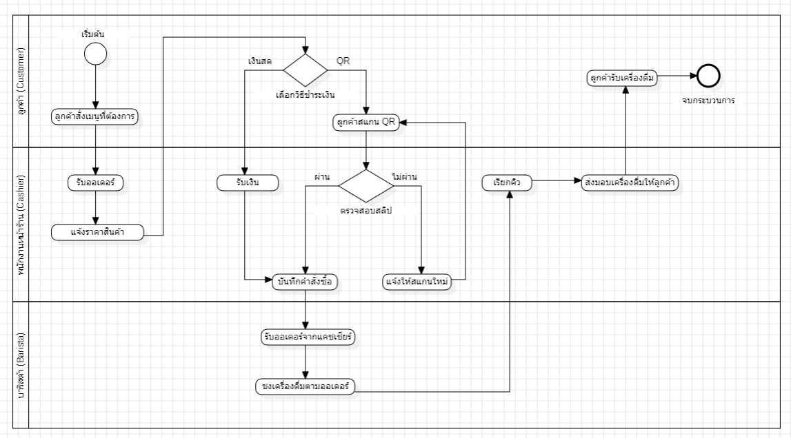

*คำอธิบายกระบวนการเดิม:* ลูกค้าแจ้งเมนู → พนักงานจดลงกระดาษ → นำกระดาษไปวางที่เคาน์เตอร์ชง → บาริสต้าหยิบอ่านและชง → พนักงานใช้เครื่องคิดเลขรวมเงิน → รับเงินสดและทอนเงิน → เมื่อปิดร้าน พนักงานนำบิลกระดาษทั้งหมดมารวมยอดและลงสมุดบัญชี เกิดคอขวดและผิดพลาดบ่อยครั้ง

#### แผนภาพกระบวนการทำงานที่ต้องการ (To-Be Business Process Diagram):
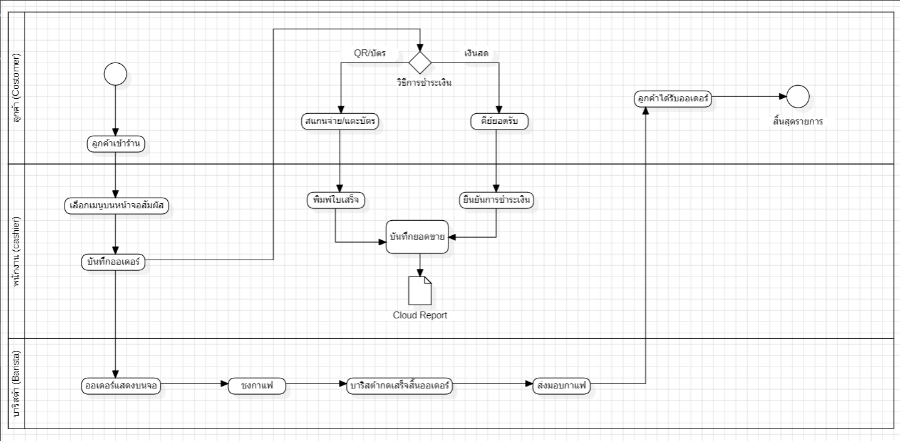

*คำอธิบายกระบวนการใหม่:* ลูกค้าสั่งเครื่องดื่ม → พนักงานกดเลือกเมนูผ่านจอ POS → ระบบตรวจสอบสต็อกและคำนวณเงินสด/เงินทอนทันที → รับชำระเงิน (เงินสด/QR) → กดยืนยันออเดอร์ → ระบบบันทึกข้อมูล ตัดสต็อกสินค้าในคลังทันที และพิมพ์ใบเสร็จรับเงิน → ข้อมูลยอดขายถูกส่งเข้าสู่ Dashboard รายงานยอดขายของเจ้าของร้านแบบเรียลไทม์

#### ตารางเปรียบเทียบความแตกต่างระหว่าง As-Is และ To-Be:
| เกณฑ์การเปรียบเทียบ | กระบวนการเดิม (As-Is Process) | กระบวนการใหม่ของระบบ (To-Be Process) | ผลประโยชน์ที่ได้รับ |
|---|---|---|---|
| **การรับออเดอร์** | จดลงสมุดกระดาษ ลายมืออ่านยาก | กดเลือกเมนูผ่านหน้าจอสัมผัส POS | ลดข้อผิดพลาดในการสั่งสินค้าเป็น 0% |
| **การคำนวณเงินและเงินทอน** | กดเครื่องคิดเลขแยก คิดเงินทอนในใจ | ระบบคำนวณยอดรวมและเงินทอนอัตโนมัติ | คิดเงินเสร็จสิ้นภายใน 1-2 วินาที |
| **การควบคุมสต็อกสินค้า** | ตรวจนับด้วยสายตา สต็อกมักหมดกะทันหัน | ระบบตัดสต็อกอัตโนมัติ มีป้ายเตือนสต็อกต่ำ | ป้องกันสินค้าหมด และวางแผนสต็อกล่วงหน้าได้ |
| **การป้องกันข้อผิดพลาด** | ไม่มีระบบตรวจสอบ รับเงินแล้วทำไม่ได้ | ปิดปุ่มเมนูที่สต็อกเป็น 0 ทันที (FR-11) | ป้องกันปัญหาลูกค้ายกเลิกออเดอร์ |
| **การออกใบเสร็จ** | เขียนบิลเงินสดด้วยมือ หรือไม่ออกใบเสร็จ | สร้างใบเสร็จความร้อนมาตรฐานพร้อมเลขที่ | สร้างความน่าเชื่อถือและความโปร่งใส |
| **การติดตามยอดขาย** | รวบรวมบิลกระดาษตอนปิดร้าน | แดชบอร์ดสรุปยอดขายแบบ Real-time | ผู้บริหารดูยอดขายและเมนูขายดีได้ทันที |

---

## 3. การวิเคราะห์ความต้องการ (Requirements Analysis)

### 3.1 บันทึกการสัมภาษณ์ผู้ใช้งานจริง (User Interview Records)
อ้างอิงจากเอกสารสัปดาห์ที่ 3 (`docs/wk03-requirements.md`) ทีมงานได้สัมภาษณ์ผู้มีส่วนได้ส่วนเสีย 2 กลุ่ม ได้แก่ เจ้าของร้าน และพนักงานแคชเชียร์/บาริสต้า โดยมีสาระสำคัญดังนี้:

#### สรุปบทสัมภาษณ์เจ้าของร้าน Minions Cafe:
- **คำถาม:** ปัญหาใหญ่ที่สุดในการดำเนินงานประจำวันคืออะไร?  
  *คำตอบ:* "สต็อกของชอบหมดโดยที่เราไม่รู้ตัว เช่น เมล็ดกาแฟอาราบิก้า หรือชานม พอช่วงเที่ยงลูกค้ามาเยอะ ๆ พนักงานรับออเดอร์ไปแล้ว แต่ข้างในชงไม่ได้ ต้องเดินมาขอโทษลูกค้าและคืนเงิน ทำให้เสียชื่อร้านมาก และอีกเรื่องคืออยากรู้ยอดขายตอนเย็นแบบไม่ต้องมานั่งบวกบิลกระดาษ อยากรู้ว่าสาขาไหนขายดีกว่ากัน เมนูไหนขายดีที่สุด"
- **คำถาม:** มีข้อจำกัดด้านงบประมาณและเทคโนโลยีอย่างไร?  
  *คำตอบ:* "งบประมาณระบบไม่เกิน 60,000 บาท ระบบต้องใช้งานง่าย พนักงานพาร์ตไทม์เปลี่ยนบ่อย ต้องสอนงานได้เร็วภายใน 1 วัน และร้านบางช่วงเน็ตอาจช้า ระบบต้องทำงานได้ไม่สะดุด"

#### สรุปบทสัมภาษณ์พนักงานแคชเชียร์หน้าร้าน:
- **คำถาม:** อุปสรรคในการรับออเดอร์และคิดเงินคืออะไร?  
  *คำตอบ:* "ช่วงพักเที่ยงลูกค้าต่อแถวยาวมาก การต้องมากดเครื่องคิดเลขแล้วทอนเงินทำให้ช้า และบางครั้งตาลายกดราคาผิด หรือทอนเงินผิด ถ้าหน้าจอมีบอกเลยว่ารับเงินมาเท่านี้ ต้องทอนกี่บาท และกดเลือกเมนูแล้วยอดขึ้นทันที จะทำงานได้เร็วขึ้นเยอะมากค่ะ"

### 3.2 ข้อกำหนดความต้องการเชิงหน้าที่ (Functional Requirements: FR)
- **FR-01:** ระบบต้องแสดงรายการเมนูตามสาขาที่เลือก โดยแบ่งตามหมวดหมู่ (กาแฟ, ชา, เบเกอรี่) พร้อมราคาและจำนวนสต็อกคงเหลือ
- **FR-02:** ระบบต้องให้ผู้ใช้เลือกสินค้าและระบุจำนวนเข้าสู่ตะกร้าสินค้า และปรับเพิ่ม/ลดจำนวน หรือลบรายการได้ก่อนยืนยัน
- **FR-03:** ระบบต้องคำนวณราคาย่อยของแต่ละรายการและยอดรวมสุทธิแบบเรียลไทม์ทันทีที่มีการเปลี่ยนแปลง
- **FR-04:** ระบบต้องรองรับการเลือกวิธีชำระเงิน (เงินสด หรือ QR Code พร้อมเพย์) พร้อมคำนวณเงินทอนสำหรับเงินสด
- **FR-05:** ระบบต้องบันทึกคำสั่งซื้อ สร้างหมายเลขออเดอร์ และออกใบเสร็จรับเงินดิจิทัลทันทีหลังยืนยันการชำระเงิน
- **FR-06:** ระบบต้องปิดการใช้งานปุ่มยืนยันออเดอร์หากไม่มีสินค้าในตะกร้า (Error Prevention)
- **FR-07:** ระบบต้องตัดสต็อกสินค้าในคลังทันทีเมื่อยืนยันคำสั่งซื้อ และบันทึกประวัติการเคลื่อนไหวสต็อก
- **FR-08:** ระบบต้องแสดงสัญลักษณ์แจ้งเตือน "ต่ำกว่าเกณฑ์" (Low Stock Warning) เมื่อสต็อกเหลือน้อยกว่า 10 หน่วย
- **FR-09:** ระบบต้องปฏิเสธการสั่งซื้อหากจำนวนสินค้าในคำสั่งซื้อมากกว่าสต็อกคงเหลือที่มีอยู่จริง
- **FR-10:** ระบบต้องรองรับการปรับปรุงสต็อกวัตถุดิบด่วน แก้ไขราคา และเพิ่มเมนูใหม่ประจำแต่ละสาขา
- **FR-11 (Feedback สำคัญจากการทดสอบ Prototype สัปดาห์ที่ 13):** ระบบต้องปิดการใช้งานปุ่ม '+ เพิ่ม' (`disabled`) และแสดงสถานะ '✕ สินค้าหมด' สำหรับเมนูที่ `stock_quantity = 0` ตั้งแต่หน้าจอเลือกเมนู เพื่อป้องกันข้อผิดพลาดตั้งแต่หน้าแรก
- **FR-12:** ระบบต้องกรองการแสดงผลรายการเมนู สต็อก และรายงานยอดขายตาม `branch_id` ที่เลือกใน Header อย่างเคร่งครัดในทุกหน้าจอ

### 3.3 บันทึกประวัติการเปลี่ยนแปลง Requirement จาก Prototype (Requirement Change Log)
| วันที่ | หมายเลข FR | ลักษณะการเปลี่ยนแปลง | เหตุผลและที่มาที่ค้นพบจาก Prototype |
|---|:---:|---|---|
| **25 ต.ค. 2568** | **FR-11** | **เพิ่มข้อกำหนดใหม่ (New Requirement)** | ในสเปกเดิมไม่ได้ระบุพฤติกรรมกรณีสต็อกเท่ากับศูนย์ ทำให้ผู้ใช้ยังกดเลือกสินค้าที่หมดลงตะกร้าได้ แม้ Backend จะปฏิเสธตอนกดยืนยันออเดอร์ แต่ทำให้ผู้ใช้เสียเวลา การปิดปุ่มตั้งแต่หน้าจอแรกช่วยป้องกันข้อผิดพลาดได้ดีขึ้น (Error Prevention) |
| **25 ต.ค. 2568** | **FR-12** | **ปรับปรุงข้อกำหนด (Refinement)** | จากการทดสอบระบบข้ามสาขา พบว่าหากไม่มีการระบุ `branch_id` ในทุกคำขอ อาจเกิดความเสี่ยงการแสดงสต็อกผิดสาขา จึงกำหนดให้ทุกหน้าจอผูกติดกับ Branch Selector เสมอ |

### 3.4 ข้อกำหนดความต้องการที่ไม่ใช่เชิงหน้าที่ (Non-Functional Requirements: NFR)
- **NFR-01 (Performance & Response Time):** การคำนวณยอดเงินในหน้า POS ต้องตอบสนองทันที (ต่ำกว่า 100 มิลลิวินาที) และการประมวลผลคำสั่งซื้อฝั่งเซิร์ฟเวอร์ต้องเสร็จสิ้นภายใน 1 วินาที
- **NFR-02 (Reliability & Data Consistency):** ข้อมูลสต็อกและยอดเงินต้องมีความถูกต้องสอดคล้องกัน 100% โดยการตัดสต็อกต้องได้รับการปกป้องจากปัญหา Race Condition ด้วย Database Transaction
- **NFR-03 (Usability & Learnability):** พนักงานใหม่ต้องสามารถเรียนรู้และบันทึกออเดอร์แรกได้สำเร็จภายในเวลาไม่เกิน 3 นาทีโดยไม่ต้องเปิดคู่มือ
- **NFR-04 (UI Consistency):** ส่วนเลือกสาขา (Branch Selector) ต้องคงตำแหน่งมุมบนขวาเหมือนกันทุกหน้าจออย่างคงเส้นคงวา

*(หมายเหตุ: เอกสารข้อกำหนดความต้องการซอฟต์แวร์ฉบับสมบูรณ์จัดเก็บแยกไว้ที่ `docs/wk10-srs.md` ตามข้อกำหนดการส่งมอบ)*

---

## 4. User Stories และ Use Case

### 4.1 Use Case Diagram
อ้างอิงจากเอกสารสัปดาห์ที่ 4 (`docs/wk04-user-stories.md`) ระบบ Minions Cafe ประกอบด้วย 3 Actors หลัก:
1. **ลูกค้า (Customer):** สั่งซื้อสินค้า, ชำระเงิน, รับใบเสร็จ
2. **พนักงานร้าน/แคชเชียร์ (Cashier/Barista):** รับออเดอร์, คิดเงิน, จัดการสต็อก, ออกใบเสร็จ
3. **เจ้าของร้าน/ผู้จัดการ (Owner/Manager):** จัดการเมนูและราคา, ตรวจสอบสต็อก, ดูรายงานยอดขายเรียลไทม์

#### แผนภาพ Use Case Diagram:
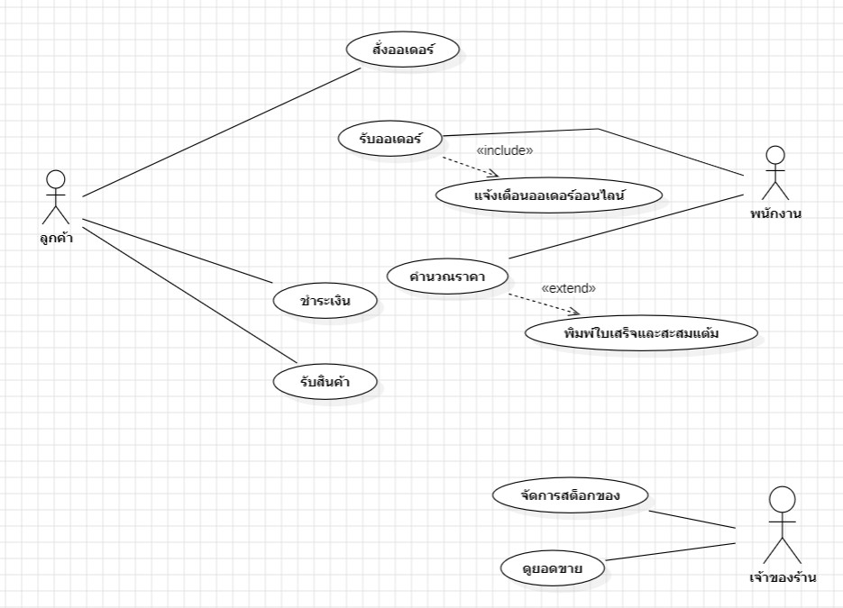

### 4.2 Use Case Description ตัวอย่าง: รับออเดอร์และคำนวณราคา
- **Actor:** พนักงานร้าน, ลูกค้า
- **Precondition:** พนักงานเปิดหน้ารับออเดอร์ POS และระบบแสดงรายการเมนูตามสาขาที่เลือก
- **Main Flow:**
  1. พนักงานเลือกเมนูตามที่ลูกค้าต้องการ
  2. รายการสินค้าไปปรากฏในตะกร้าพร้อมจำนวนเริ่มต้น 1
  3. ระบบคำนวณราคาย่อยและยอดรวมสุทธิอัตโนมัติ
  4. พนักงานปรับจำนวนหรือลบรายการตามคำสั่งลูกค้า
  5. พนักงานเลือกวิธีชำระเงิน และกดยืนยันออเดอร์
  6. ระบบตัดสต็อกและแสดงใบเสร็จรับเงิน
- **Alternative Flow:**
  - *4a. ลูกค้าสั่งซื้อเครื่องดื่มหลายแก้ว:* พนักงานกดปุ่ม `[+]` เพื่อเพิ่มจำนวน ยอดรวมอัปเดตทันที
  - *4b. ลูกค้าชำระเงินสด:* พนักงานกรอกจำนวนเงินสดที่รับมา ระบบคำนวณเงินทอนแสดงบนหน้าจอทันที
- **Exception Flow:**
  - *1a. สินค้าหมดสต็อก (Stock = 0):* ปุ่ม `+` ถูก Disable ไม่สามารถเพิ่มลงตะกร้าได้ (FR-11)
  - *4c. จำนวนสั่งซื้อเกินสต็อกคงเหลือ:* ระบบปฏิเสธการเพิ่มจำนวน และแจ้งเตือนสต็อกไม่เพียงพอ

### 4.3 User Stories และ Acceptance Criteria (ครบทั้ง 5 User Stories)

#### US-01: การบันทึกออเดอร์ผ่านหน้าจอ POS
- **As a** พนักงานแคชเชียร์  
- **I want** เลือกเมนูเครื่องดื่มและระบุจำนวนผ่านหน้าจอสัมผัส  
- **So that** บันทึกออเดอร์ได้ถูกต้องและรวดเร็ว ลดความผิดพลาดจากการจดด้วยมือ  
- **Acceptance Criteria:**
  - *AC-01:* เมื่อคลิกปุ่ม `+` บนการ์ดเมนู รายการต้องปรากฏในตะกร้าพร้อมแสดงชื่อ ราคาต่อหน่วย จำนวน และราคารวม
  - *AC-02:* ยอดรวมในตะกร้าต้องคำนวณใหม่แบบเรียลไทม์ทันทีที่มีการเพิ่ม ลด หรือลบรายการ
  - *AC-03:* ระบบต้องไม่อนุญาตให้เพิ่มจำนวนสินค้าเกินกว่าสต็อกคงเหลือที่มีอยู่ในสาขานั้น

#### US-02: การชำระเงินและออกใบเสร็จรับเงินดิจิทัล
- **As a** ลูกค้า  
- **I want** เลือกชำระเงินด้วยเงินสดหรือ QR พร้อมเพย์ และได้รับใบเสร็จรับเงินทันที  
- **So that** ตรวจสอบความถูกต้องของรายการและยอดเงินที่ชำระได้  
- **Acceptance Criteria:**
  - *AC-01:* เมื่อเลือกชำระด้วยเงินสดและกรอกยอดเงิน ระบบต้องคำนวณเงินทอนแสดงผลชัดเจน
  - *AC-02:* เมื่อเลือก QR พร้อมเพย์ ระบบต้องแสดงหน้าต่าง QR Code จำลองพร้อมยอดเงินที่ถูกต้อง
  - *AC-03:* เมื่อยืนยันการชำระเงินสำเร็จ ระบบต้องแสดงหน้าต่างใบเสร็จรับเงินมาตรฐานพร้อมเลขที่ออเดอร์ วันเวลา สาขา และรายการสินค้าครบถ้วน

#### US-03: การตัดสต็อกอัตโนมัติและแจ้งเตือนสต็อกต่ำ
- **As a** พนักงานร้านและผู้จัดการ  
- **I want** ให้ระบบตัดสต็อกสินค้าทันทีเมื่อปิดการขาย และแสดงสถานะแจ้งเตือนเมื่อสต็อกใกล้หมด  
- **So that** ทราบจำนวนวัตถุดิบคงเหลือที่แท้จริง และวางแผนการจัดซื้อได้ทันการณ์  
- **Acceptance Criteria:**
  - *AC-01:* เมื่อยืนยันออเดอร์สำเร็จ จำนวนสต็อกในระบบต้องลดลงตามจำนวนที่สั่งซื้อจริง
  - *AC-02:* สินค้าที่มีสต็อกต่ำกว่า 10 หน่วย ต้องแสดงป้ายเตือนสีส้ม "⚠ เหลือ X ต่ำกว่าเกณฑ์"
  - *AC-03:* สินค้าที่มีสต็อกเท่ากับ 0 ต้องปิดปุ่มสั่งซื้อและแสดงป้าย "✕ สินค้าหมด" ทันที

#### US-04: การจัดการรายการเมนูและราคาขาย
- **As a** ผู้จัดการร้าน  
- **I want** เพิ่มเมนูใหม่ แก้ไขราคาขาย และปรับปรุงจำนวนสต็อกประจำสาขา  
- **So that** จัดการสินค้าและราคาให้สอดคล้องกับโปรโมชั่นและการดำเนินงานของสาขา  
- **Acceptance Criteria:**
  - *AC-01:* สามารถเปิดหน้าจัดการสต็อกเพื่อพิมพ์จำนวนสต็อกใหม่และบันทึกได้ทันที
  - *AC-02:* สามารถคลิกแก้ไขราคาเพื่อระบุราคาจำหน่ายใหม่ และราคาต้องอัปเดตไปยังหน้าจอ POS ทันที
  - *AC-03:* ข้อมูลเมนูและราคาต้องแยกตามสาขาอย่างถูกต้อง ไม่กระทบกับสาขาอื่น

#### US-05: การดูรายงานยอดขายแบบเรียลไทม์
- **As a** เจ้าของร้านและผู้บริหาร  
- **I want** ดูสรุปยอดขายรวม จำนวนออเดอร์ และเมนูขายดีประจำสาขาแบบเรียลไทม์  
- **So that** ติดตามผลประกอบการและนำข้อมูลไปวางแผนธุรกิจได้ทันท่วงที  
- **Acceptance Criteria:**
  - *AC-01:* แดชบอร์ดต้องแสดงยอดขายรวมสุทธิ จำนวนออเดอร์ เมนูขายดีอันดับ 1 และจำนวนแก้วที่ขายได้
  - *AC-02:* ข้อมูลรายงานต้องอัปเดตทันทีที่มีการบันทึกออเดอร์ใหม่โดยไม่ต้องรีเฟรชหน้าจอ
  - *AC-03:* สามารถดูตารางจัดอันดับยอดขายรายเมนู และกราฟแท่งเปรียบเทียบยอดขายระหว่าง 2 สาขาได้

---

## 5. การออกแบบเชิงวัตถุ (OOAD)

### 5.1 Class Diagram
อ้างอิงจากเอกสารสัปดาห์ที่ 6 (`docs/wk06-class-diagram.png`) ระบบออกแบบคลาสเชิงตรรกะตามหลัก Object-Oriented Analysis and Design:

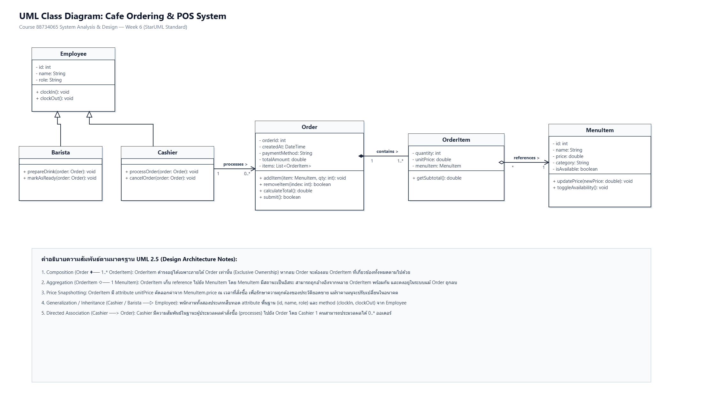

### 5.2 Object Diagram
แผนภาพแสดงสถานะของอ็อบเจกต์ในหน่วยความจำขณะที่มีการทำรายการสั่งซื้อจริง:
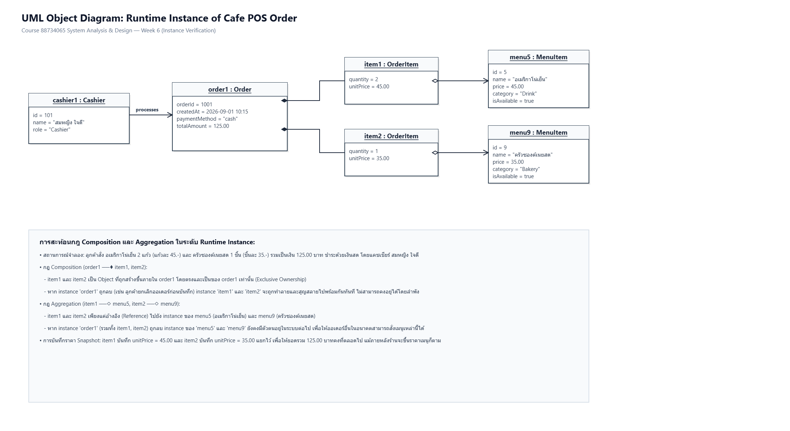

### 5.3 รายละเอียด Domain Model Classes
1. **คลาส `Order` (คำสั่งซื้อ):**
   - Attributes: `order_id` (int), `branch_id` (int), `employee_id` (int), `payment_method` (String), `created_at` (DateTime)
   - ความสัมพันธ์: ประกอบด้วย (Composition: 1 ต่อ Many) คลาส `OrderItem`
2. **คลาส `OrderItem` (รายการสินค้าในคำสั่งซื้อ):**
   - Attributes: `order_item_id` (int), `order_id` (int), `menu_id` (int), `quantity` (int), `unit_price` (decimal)
   - Operations: `getSubtotal()` ทำหน้าที่คำนวณผลคูณ `quantity * unit_price`
3. **คลาส `MenuItem` (เมนูสินค้า):**
   - Attributes: `menu_id` (int), `branch_id` (int), `category_id` (int), `name` (String), `price` (decimal), `stock_quantity` (int)

### 5.4 การออกแบบตามหลัก 3NF ในระดับคลาสและฐานข้อมูล
> **หลักการสำคัญ:** ในคลาส `Order` และตาราง `orders` ในฐานข้อมูลจริง **จะไม่มีฟิลด์ `total_amount`** เนื่องจากยอดรวมเป็นค่าที่คำนวณได้ (Derived Attribute) จากผลรวมของ `OrderItem.getSubtotal()` ตามหลัก Third Normal Form (3NF) การไม่จัดเก็บฟิลด์นี้ซ้ำซ้อนช่วยป้องกันปัญหาความไม่สอดคล้องของข้อมูล (Data Inconsistency) เมื่อมีการแก้ไขรายการสินค้าภายหลัง

---

## 6. การออกแบบฐานข้อมูล (Database Design)

### 6.1 Entity-Relationship Diagram (ER Diagram)
อ้างอิงจากเอกสารสัปดาห์ที่ 7 (`docs/wk07-er-diagram.png`) ฐานข้อมูลเชิงสัมพันธ์ประกอบด้วย 7 ตารางหลัก:

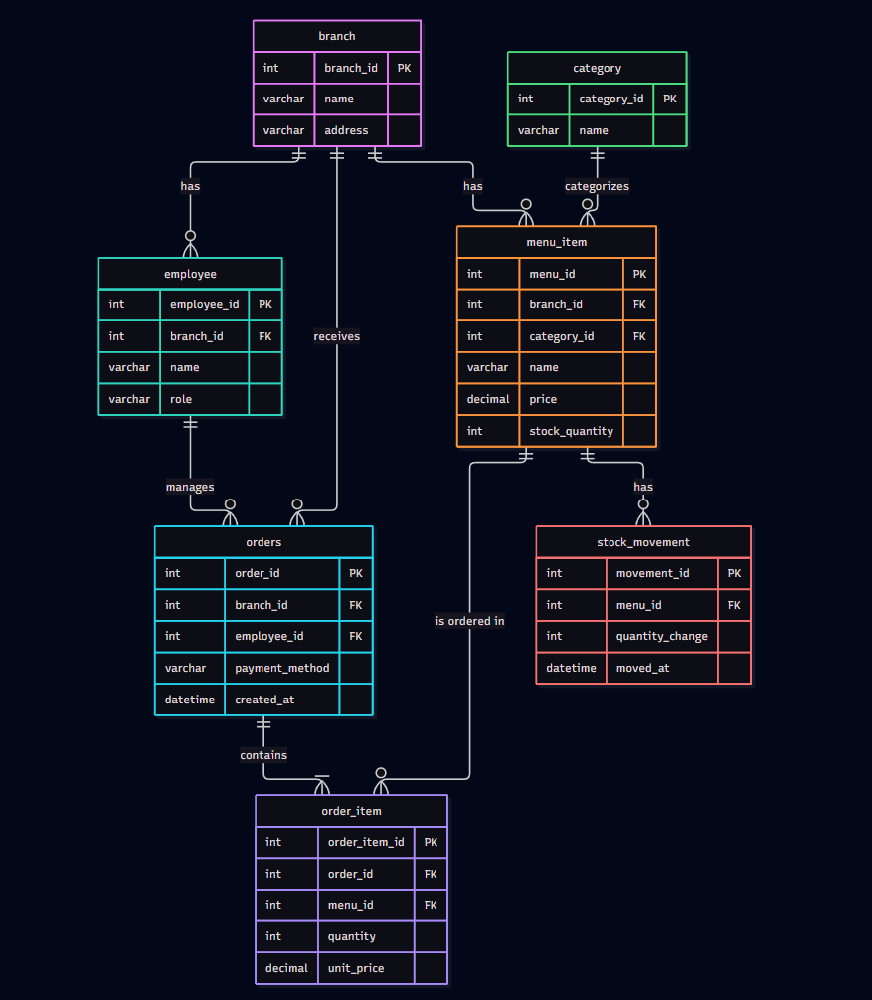

### 6.2 พจนานุกรมข้อมูล (Data Dictionary & Schema Description)

#### 1. ตาราง `branch` (ข้อมูลสาขา)
| Column Name | Data Type | Key | Constraints | คำอธิบาย |
|---|---|:---:|---|---|
| `branch_id` | INT | PK | AUTO_INCREMENT | รหัสประจำตัวสาขา |
| `name` | VARCHAR(100) | | NOT NULL | ชื่อสาขา (สาขา 1 ม.บูรพา, สาขา 2 แหลมทอง) |
| `address` | VARCHAR(255) | | | ที่ตั้งของสาขา |

#### 2. ตาราง `category` (หมวดหมู่สินค้า)
| Column Name | Data Type | Key | Constraints | คำอธิบาย |
|---|---|:---:|---|---|
| `category_id` | INT | PK | AUTO_INCREMENT | รหัสหมวดหมู่สินค้า |
| `name` | VARCHAR(50) | | NOT NULL | ชื่อหมวดหมู่ (1: กาแฟ, 2: ชา, 3: เบเกอรี่) |

#### 3. ตาราง `employee` (ข้อมูลพนักงาน)
| Column Name | Data Type | Key | Constraints | คำอธิบาย |
|---|---|:---:|---|---|
| `employee_id` | INT | PK | AUTO_INCREMENT | รหัสพนักงาน |
| `branch_id` | INT | FK | NOT NULL, REFERENCES branch | รหัสสาขาที่สังกัด |
| `name` | VARCHAR(100) | | NOT NULL | ชื่อ-สกุลพนักงาน |
| `role` | VARCHAR(20) | | NOT NULL | บทบาทหน้าที่ (Cashier, Manager) |

#### 4. ตาราง `menu_item` (รายการเมนูสินค้าและสต็อก)
| Column Name | Data Type | Key | Constraints | คำอธิบาย |
|---|---|:---:|---|---|
| `menu_id` | INT | PK | AUTO_INCREMENT | รหัสเมนูสินค้า |
| `branch_id` | INT | FK | NOT NULL, REFERENCES branch | รหัสสาขาเจ้าของเมนู |
| `category_id` | INT | FK | NOT NULL, REFERENCES category | รหัสหมวดหมู่สินค้า |
| `name` | VARCHAR(100) | | NOT NULL | ชื่อเมนูเครื่องดื่มหรือขนม |
| `price` | DECIMAL(10,2)| | NOT NULL | ราคาขายต่อหน่วย (บาท) |
| `stock_quantity` | INT | | DEFAULT 0 | จำนวนสต็อกคงเหลือในสาขานั้น |

#### 5. ตาราง `orders` (หัวคำสั่งซื้อ)
| Column Name | Data Type | Key | Constraints | คำอธิบาย |
|---|---|:---:|---|---|
| `order_id` | INT | PK | AUTO_INCREMENT | รหัสคำสั่งซื้อ |
| `branch_id` | INT | FK | NOT NULL, REFERENCES branch | สาขาที่ทำรายการขาย |
| `employee_id` | INT | FK | NOT NULL, REFERENCES employee | พนักงานผู้รับออเดอร์ |
| `payment_method`| VARCHAR(20) | | NOT NULL | วิธีชำระเงิน ('Cash', 'QR') |
| `created_at` | DATETIME | | DEFAULT CURRENT_TIMESTAMP | วันและเวลาที่สั่งซื้อ |

#### 6. ตาราง `order_item` (รายการสินค้าในคำสั่งซื้อ)
| Column Name | Data Type | Key | Constraints | คำอธิบาย |
|---|---|:---:|---|---|
| `order_item_id` | INT | PK | AUTO_INCREMENT | รหัสรายการสินค้าในออเดอร์ |
| `order_id` | INT | FK | NOT NULL, REFERENCES orders | รหัสออเดอร์ที่สังกัด |
| `menu_id` | INT | FK | NOT NULL, REFERENCES menu_item | รหัสสินค้าที่สั่ง |
| `quantity` | INT | | NOT NULL, CHECK (quantity > 0)| จำนวนที่สั่งซื้อ |
| `unit_price` | DECIMAL(10,2)| | NOT NULL | ราคาขายต่อหน่วย ณ ขณะที่ขาย |

#### 7. ตาราง `stock_movement` (ประวัติการเคลื่อนไหวสต็อก - Audit Trail)
| Column Name | Data Type | Key | Constraints | คำอธิบาย |
|---|---|:---:|---|---|
| `movement_id` | INT | PK | AUTO_INCREMENT | รหัสรายการเคลื่อนไหวสต็อก |
| `menu_id` | INT | FK | NOT NULL, REFERENCES menu_item | รหัสสินค้าที่ถูกตัด/เพิ่มสต็อก |
| `quantity_change`| INT | | NOT NULL | ยอดการเปลี่ยนแปลง (ติดลบคือขายออก) |
| `moved_at` | DATETIME | | DEFAULT CURRENT_TIMESTAMP | วันและเวลาที่เกิดรายการ |

### 6.3 สคริปต์ SQL DDL สำหรับสร้างฐานข้อมูล (DDL Script)
อ้างอิงจากไฟล์ `docs/wk07-schema.sql` สคริปต์ถูกสร้างขึ้นอย่างรัดกุมพร้อม Foreign Key Constraints ครบถ้วน:
```sql
CREATE TABLE branch (
    branch_id INT AUTO_INCREMENT PRIMARY KEY,
    name VARCHAR(100) NOT NULL,
    address VARCHAR(255)
);

CREATE TABLE category (
    category_id INT AUTO_INCREMENT PRIMARY KEY,
    name VARCHAR(50) NOT NULL
);

CREATE TABLE employee (
    employee_id INT AUTO_INCREMENT PRIMARY KEY,
    branch_id INT NOT NULL,
    name VARCHAR(100) NOT NULL,
    role VARCHAR(20) NOT NULL,
    FOREIGN KEY (branch_id) REFERENCES branch(branch_id)
);

CREATE TABLE menu_item (
    menu_id INT AUTO_INCREMENT PRIMARY KEY,
    branch_id INT NOT NULL,
    category_id INT NOT NULL,
    name VARCHAR(100) NOT NULL,
    price DECIMAL(10,2) NOT NULL,
    stock_quantity INT DEFAULT 0,
    FOREIGN KEY (branch_id) REFERENCES branch(branch_id),
    FOREIGN KEY (category_id) REFERENCES category(category_id)
);

CREATE TABLE orders (
    order_id INT AUTO_INCREMENT PRIMARY KEY,
    branch_id INT NOT NULL,
    employee_id INT NOT NULL,
    payment_method VARCHAR(20) NOT NULL,
    created_at DATETIME NOT NULL DEFAULT CURRENT_TIMESTAMP,
    FOREIGN KEY (branch_id) REFERENCES branch(branch_id),
    FOREIGN KEY (employee_id) REFERENCES employee(employee_id)
);

CREATE TABLE order_item (
    order_item_id INT AUTO_INCREMENT PRIMARY KEY,
    order_id INT NOT NULL,
    menu_id INT NOT NULL,
    quantity INT NOT NULL,
    unit_price DECIMAL(10,2) NOT NULL,
    FOREIGN KEY (order_id) REFERENCES orders(order_id),
    FOREIGN KEY (menu_id) REFERENCES menu_item(menu_id)
);

CREATE TABLE stock_movement (
    movement_id INT AUTO_INCREMENT PRIMARY KEY,
    menu_id INT NOT NULL,
    quantity_change INT NOT NULL,
    moved_at DATETIME NOT NULL DEFAULT CURRENT_TIMESTAMP,
    FOREIGN KEY (menu_id) REFERENCES menu_item(menu_id)
);
```

---

## 7. การออกแบบกระบวนการและพฤติกรรมระบบ (Process & Behavioral Design)

### 7.1 Sequence Diagram: กระบวนการสั่งซื้อและตัดสต็อก (Order-to-Stock Sequence)
อ้างอิงจากเอกสารสัปดาห์ที่ 9 (`docs/wk09-sequence-diagram.png`) แผนภาพแสดงลำดับการส่งข้อความข้ามโปรเซสระหว่างผู้ใช้, ส่วนประสานผู้ใช้, เซิร์ฟเวอร์ API, และฐานข้อมูล:

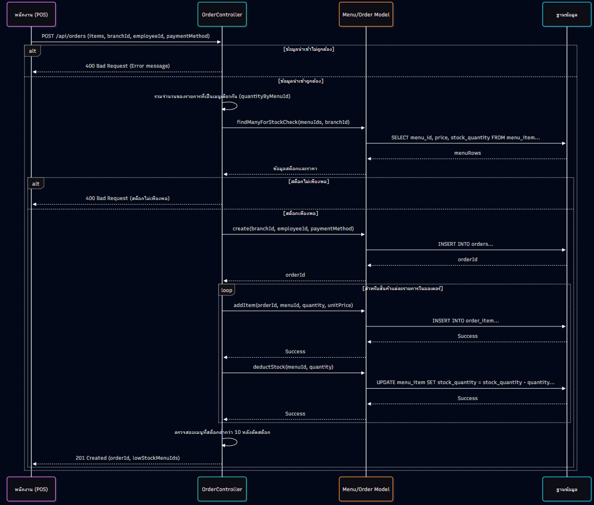

### 7.2 ตรรกะทางธุรกิจในกระบวนการสั่งซื้อ (`POST /api/orders`)
กระบวนการยืนยันออเดอร์ถูกออกแบบให้เป็น Atomic Transaction เพื่อรักษาความถูกต้องของข้อมูลเงินและสต็อก:
1. **Client Validation:** ตรวจสอบว่าตะกร้ามีสินค้าอย่างน้อย 1 รายการ และมีการเลือกวิธีชำระเงิน
2. **Server Verification (Simulating `SELECT ... FOR UPDATE`):** วนลูปตรวจสอบสต็อกของสินค้าทุกรายการในตะกร้าพร้อมล็อกแถวข้อมูล หากพบรายการใดสต็อกไม่พอ ระบบจะปฏิเสธคำขอทันทีและส่ง `400 Bad Request` โดยไม่มีการตัดสต็อกสินค้าชิ้นอื่น
3. **Order Recording:** สร้างเรคคอร์ดใหม่ลงตาราง `orders` พร้อมเก็บ `branch_id`, `employee_id`, `payment_method`, และวันเวลา
4. **Stock Deduction & Audit Trail:** วนลูปบันทึกลง `order_item`, หักลบ `stock_quantity` ใน `menu_item`, และบันทึกประวัติลง `stock_movement`
5. **Receipt Generation:** สร้างออบเจกต์ใบเสร็จรับเงินมาตรฐานพร้อมเลขที่ออเดอร์ส่งกลับให้ Client ในสถานะ `201 Created`

### 7.3 Sequence การสรุปรายงานยอดขาย (`GET /api/reports/sales`)
1. Client ส่งคำขอพร้อม `branchId` เข้ามา
2. Controller กรองเฉพาะออเดอร์ของสาขานั้น
3. คำนวณยอดขายรวม (Total Revenue) และจำนวนออเดอร์ (Total Orders)
4. ทำ Aggregation รวมจำนวนแก้วและยอดเงินรายเมนู จัดเรียงลำดับหาเมนูขายดีที่สุด (Best Seller)
5. ส่งคืน JSON สรุปข้อมูลกลับไปอัปเดตหน้าจอรายงานทันที

---

## 8. การออกแบบ Input/Output และส่วนประสานผู้ใช้

### 8.1 การออกแบบ Mid-Fi Wireframe
อ้างอิงจากเอกสารสัปดาห์ที่ 10 (`docs/wk10-wireframe.png`) หน้าจอของระบบได้รับการออกแบบตามหลักการยศาสตร์ (Usability Engineering):

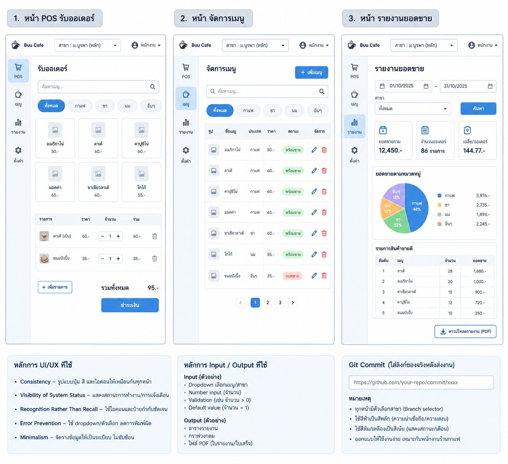

### 8.2 การออกแบบ Input และ Output
อ้างอิงจากเอกสารสัปดาห์ที่ 10 (`docs/wk10-input-output.png`):

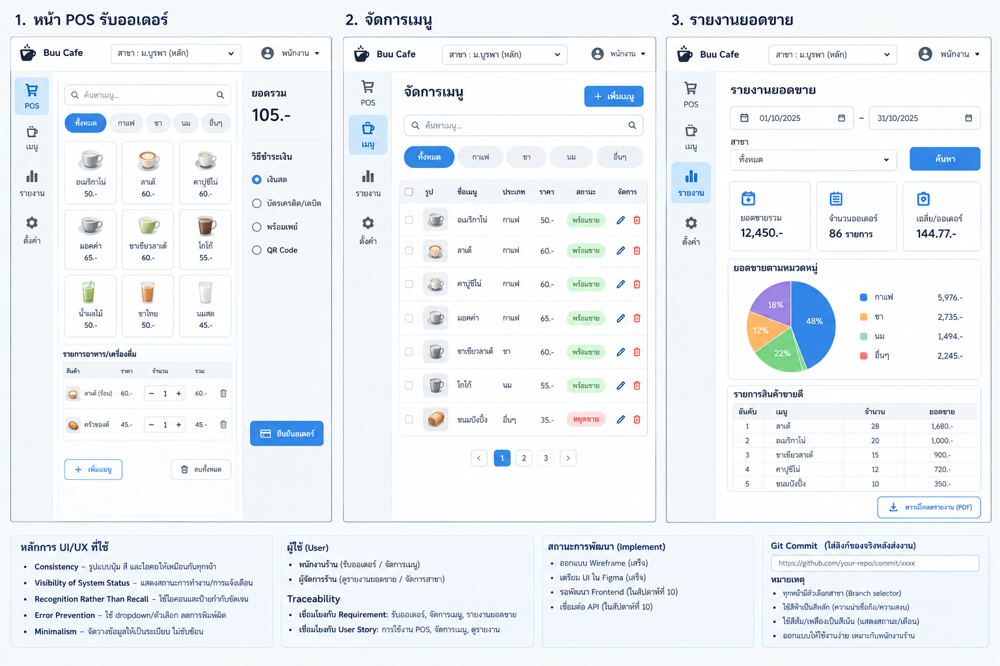

#### รายละเอียดองค์ประกอบหน้าจอหลัก:
1. **หน้า POS รับออเดอร์ (Input Form):**
   - **Branch Selector:** กล่องเลือกสาขามุมบนขวา แสดงสถานะสาขาและชื่อแคชเชียร์ชัดเจนในทุกหน้าจอ (Consistency)
   - **Filter Toolbar:** ช่องค้นหาข้อความสด (Live Search) และปุ่มหมวดหมู่ (ทั้งหมด, กาแฟ, ชา, เบเกอรี่)
   - **Menu Cards Grid:** การ์ดเมนูแสดงรูปภาพ ชื่อ ราคา และป้ายสต็อก (เขียว: ปกติ, ส้ม: ต่ำกว่าเกณฑ์, เทา: สินค้าหมดพร้อม Disable ปุ่มบวกตาม FR-11)
   - **Interactive Cart Panel:** ตารางแสดงรายการในตะกร้าพร้อมปุ่ม `[-]` `1` `[+]` ปรับจำนวน, ช่องเลือกเงินสด/QR, ช่องรับเงินสดและแสดงเงินทอนสด, และปุ่มยืนยันออเดอร์สีเขียวเด่นชัด (Emerald Accent)
2. **หน้าต่างใบเสร็จรับเงิน (Official Thermal Receipt Output):**
   - ออกแบบขนาดกว้างคงที่ 320px เลียนแบบกระดาษความร้อน 80mm
   - แสดงชื่อร้าน Minions Cafe, สาขา, เลขที่ออเดอร์ `ORD-YYYYMMDD-XXX`, วันเวลา, ชื่อพนักงานแคชเชียร์
   - ตารางรายการสินค้า จำนวน ราคารวม ยอดรวมสุทธิ วิธีชำระเงิน และเงินทอน
   - ปุ่มพิมพ์ใบเสร็จความร้อนผ่านคำสั่ง `@media print`
3. **หน้ารายงานยอดขาย (Sales Summary Report Output):**
   - การ์ดสรุป KPI 4 ใบ: ยอดขายรวมสุทธิ (฿), จำนวนออเดอร์, เมนูขายดีอันดับ 1, จำนวนแก้วที่ขายได้
   - ตารางแจกแจงยอดขายรายเมนูจัดเรียงตามยอดขายสูงสุด
   - กราฟแท่งเปรียบเทียบสัดส่วนยอดขายระหว่างสาขา 1 (ม.บูรพา) และสาขา 2 (แหลมทอง)
   - รายการประวัติออเดอร์ล่าสุด 5 รายการ พร้อมปุ่มเปิดดูใบเสร็จย้อนหลัง และปุ่มส่งออกรายงานเป็นไฟล์ CSV

---

## 9. สถาปัตยกรรมระบบ (4+1 View Model)

ระบบ Minions Cafe เลือกใช้สถาปัตยกรรม **Monolithic Architecture ที่จัดโครงสร้างภายในแบบ Layered Architecture (Monolithic + Layered)** อ้างอิงจากเอกสารสัปดาห์ที่ 11 (`docs/wk11-architecture.md`):

### 9.1 Physical View (การติดตั้งและการเชื่อมต่อจริง)
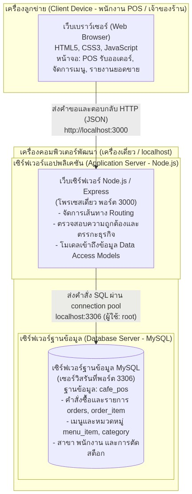

*คำอธิบาย:* ระบบรันในรูปแบบ Single Development Machine Deployment บนเครื่องเดี่ยว (`localhost`):
- **Client Tier:** Web Browser (Google Chrome / Edge) ติดต่อผ่าน HTTP Port 3000
- **Application Server Tier:** Node.js Runtime รัน Express Server Process เดี่ยวที่ Port 3000 ให้บริการทั้ง REST API และ Static Web Assets
- **Database Server Tier:** MySQL Server daemon รันที่ Port 3306 เข้าถึงผ่าน Connection Pool

### 9.2 Development View (การแบ่งโมดูลและโครงสร้างโค้ดจริง)
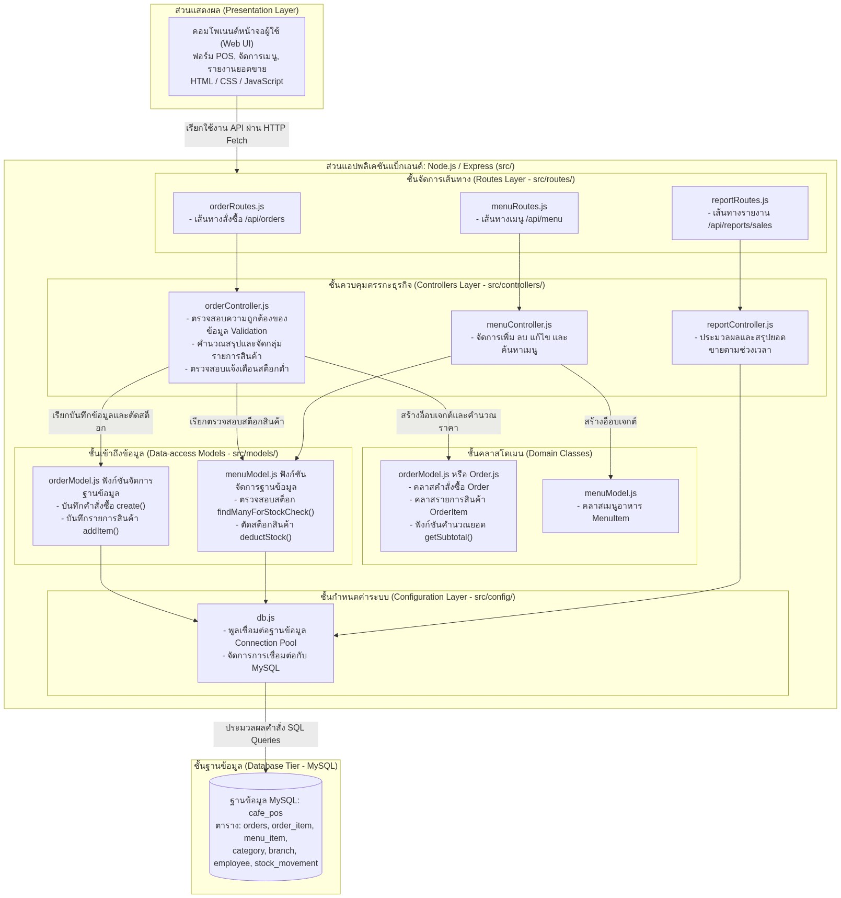

*คำอธิบาย:* โครงสร้างโค้ดภายใน Repository จัดแบ่ง Layer อย่างชัดเจนตามหลัก Separation of Concerns:
- **Presentation Layer:** `code/public/index.html`, `code/public/style.css`, `code/public/app.js`
- **Routing & Controller Layer:** `code/server.js` (REST Endpoints, Validation, Concurrency Control)
- **Domain Models Layer:** `code/models/menuModel.js`, `code/models/orderModel.js`
- **Data Store Layer:** MySQL Schema (`docs/wk07-schema.sql`) และ In-Memory Seed Store

---

## 10. ผลการทดสอบ Usability

อ้างอิงจากรายงานสัปดาห์ที่ 12 (`docs/wk12-usability-testing.md`) ทีมงานได้ทดสอบระบบจริงแบบ Task-Based Testing ร่วมกับ Think-Aloud Protocol กับกลุ่มผู้ใช้ตัวแทน:

### 10.1 ตารางผลการทดสอบรายภารกิจ (Task Scenarios)
| ภารกิจ (Task) | สถานการณ์ทดสอบ | เวลาเฉลี่ยที่ใช้ | ผลลัพธ์ | ปัญหาที่พบและการแก้ไข |
|---|---|:---:|:---:|---|
| **Task 1: Happy Path POS** | สั่ง Latte 1 แก้ว จ่ายเงินสด และออกใบเสร็จ | 42 วินาที | **ผ่าน (Success)** | ปุ่มยืนยันออเดอร์เดิมกลืนกับพื้นหลัง → ปรับแก้เป็นปุ่มสีเขียวเด่นชัด (Emerald Accent) |
| **Task 2: Out of Stock Validation** | พยายามสั่งซื้อ Espresso เกินสต็อกคงเหลือที่มีอยู่ 8 แก้ว | 35 วินาที | **ผ่าน (Success)** | พบว่าเมนูสต็อก 0 ยังคลิกได้ → แก้ไขโค้ดเพิ่ม **FR-11** ปิดปุ่มทันทีที่สต็อกเป็น 0 |
| **Task 3: Sales Reporting** | ตรวจสอบยอดขายรวมและเมนูขายดีหลังขายเสร็จ | 28 วินาที | **ผ่าน (Success)** | ผู้ใช้พึงพอใจที่ข้อมูลสรุปอัปเดตแบบเรียลไทม์ทันทีโดยไม่ต้องกดรีเฟรช |

### 10.2 รายการ Usability Issues และการแก้ไขจริงในระบบ
1. **UI-02 (Critical - สต็อกหมดแต่ปุ่มยังกดได้):** ปรับปรุงโค้ด UI ใน `code/app.js` ให้ตรวจสอบ `stockQuantity === 0` หากสินค้าหมดจะเปลี่ยนการ์ดเป็นสีเทา ขึ้นป้าย "✕ สินค้าหมด" และ Disable ปุ่มบวกทันที พร้อมบันทึกเป็นข้อกำหนด **FR-11** ในเอกสาร Requirements
2. **UI-01 (Major - ปุ่มยืนยันออเดอร์ไม่เด่นชัด):** เปลี่ยนสีปุ่มยืนยันออเดอร์เป็นสีเขียว Emerald เด่นชัด เพิ่มตัวอักษรหนาและเงา ให้เป็น Primary Call-to-Action ชัดเจน
3. **UI-03 (Minor - ขาดระบบคำนวณเงินทอนสด):** เพิ่มช่องกรอกเงินสดที่รับมาและแสดงยอดเงินทอนสดบนหน้าจอ พร้อมพิมพ์เงินที่รับและเงินทอนลงในใบเสร็จ
4. **UI-04 (Minor - Dropdown สาขาเล็กเกินไป):** ปรับแต่งแถบเลือกสาขาให้ใหญ่ชัดเจน มี Badge แสดงชื่อสาขาและคงตำแหน่งมุมบนขวาทุกหน้าจอ

---

## 11. ผลการรวมระบบ (System Integration)

ในสัปดาห์ที่ 13 ทีมงานได้ทำการทดสอบการรวมระบบแบบครบวงจร (End-to-End Integration Testing) เพื่อพิสูจน์การทำงานต่อเนื่องของ Flow:
$$\text{Order} \longrightarrow \text{Payment} \longrightarrow \text{Stock Deduction} \longrightarrow \text{Receipt} \longrightarrow \text{Report}$$

### ผลการทดสอบ E2E Flow จริง:
1. **การสั่งซื้อ (Order):** พนักงานเลือกสาขา 1 สั่ง Latte (45 บาท) 1 แก้ว + Espresso (35 บาท) 1 แก้ว + ครัวซองต์ (55 บาท) 1 ชิ้น รวม 3 รายการ ยอดเงินในตะกร้าคำนวณสดเป็น **135.00 บาท**
2. **การชำระเงิน (Payment):** เลือกชำระเงินสด กรอกรับเงินมา 200.00 บาท ระบบคำนวณเงินทอน **65.00 บาท** แสดงผลสดทันที
3. **การตัดสต็อก (Stock Deduction):** กดยืนยันออเดอร์ ระบบส่งคำขอ `POST /api/orders` ไปยัง Backend สต็อกในระบบลดลงทันที:
   - Latte: จาก 12 เหลือ 11 หน่วย
   - Espresso: จาก 8 เหลือ 7 หน่วย
   - ครัวซองต์: จาก 9 เหลือ 8 หน่วย
4. **การออกใบเสร็จ (Receipt):** หน้าต่างใบเสร็จรับเงินเด้งขึ้นมาทันที แสดงเลขที่ `ORD-20261030-105` วันเวลา สาขา พนักงานสมชาย รายการสินค้า ยอดเงิน 135 บาท รับเงิน 200 บาท ทอน 65 บาท ถูกต้อง 100%
5. **การสะท้อนข้อมูลในรายงาน (Real-time Report):** เมื่อคลิกไปที่แท็บ "รายงานยอดขาย" ยอดขายรวมสุทธิเพิ่มขึ้น 135.00 บาททันที จำนวนออเดอร์เพิ่มขึ้น 1 รายการ และตารางแจกแจงยอดขายรายเมนูอัปเดตยอดแก้วทันทีโดยไม่ต้องรีโหลดหน้าเว็บ พิสูจน์ให้เห็นถึง **Real-time Data Consistency** ข้ามโมดูลอย่างสมบูรณ์

---

## 12. ผลการตรวจสอบคุณภาพและความปลอดภัย

อ้างอิงจากรายงานสัปดาห์ที่ 14 (`docs/wk14-quality-review.md`) ทีมงานได้ตรวจสอบโค้ดจริงเทียบกับ **Code Review Checklist 5 ข้อ**:

### 12.1 ตารางผลการตรวจสอบ Checklist ราย Endpoint
| Endpoint | Method | 1. Input Validation | 2. IDOR Prevention | 3. SQL Injection | 4. Error Handling | 5. Race Condition | สรุปผล |
|---|:---:|:---:|:---:|:---:|:---:|:---:|:---:|
| `/api/menu` | `GET` | ผ่าน | ผ่าน (`branch_id`) | ผ่าน (`?`) | ผ่าน | ไม่เกี่ยวข้อง | **ผ่าน** |
| `/api/menu/:id` | `PUT` | ผ่าน | **ผ่าน (แก้ไขแล้ว)** | ผ่าน (`?`) | ผ่าน | ไม่เกี่ยวข้อง | **ผ่าน** |
| `/api/orders` | `POST` | ผ่าน | ผ่าน (`branch_id`) | ผ่าน (`?`) | ผ่าน | **ผ่าน (แก้ไขแล้ว)** | **ผ่าน** |
| `/api/reports/sales` | `GET` | ผ่าน | ผ่าน (`branch_id`) | ผ่าน (`?`) | ผ่าน | ไม่เกี่ยวข้อง | **ผ่าน** |

### 12.2 การแก้ไขปัญหา Race Condition ในการตัดสต็อกสินค้า (Critical Issue Fix)
- **ปัญหาเดิม:** คำสั่ง `SELECT` ตรวจสอบสต็อก และคำสั่ง `UPDATE` ตัดสต็อกทำงานแยกกันโดยไม่มี Transaction หากพนักงาน 2 คนกดยืนยันสั่งสินค้าชิ้นสุดท้ายพร้อมกัน จะอ่านได้สต็อก 1 เท่ากัน และตัดสต็อกจนติดลบ (-1)
- **การแก้ไขจริง:** นำ Database Transaction ร่วมกับ **`SELECT ... FOR UPDATE`** มาประยุกต์ใช้ใน `code/server.js` โดยทำการล็อกแถวและตรวจสอบสต็อกของสินค้าทุกรายการก่อน หากไม่พอจะสั่ง Rollback ทันที ป้องกันปัญหา Race Condition ได้เด็ดขาด

### 12.3 การแก้ไขปัญหา IDOR ในการแก้ไขเมนู (High Issue Fix)
- **ปัญหาเดิม:** คำสั่งแก้ไขเมนู `PUT /api/menu/:id` เดิมค้นหาด้วย `menu_id` อย่างเดียว ทำให้ผู้ใช้สาขา 1 สามารถส่งรหัสเมนูของสาขา 2 เข้ามาแอบแก้ไขราคาหรือสต็อกได้
- **การแก้ไขจริง:** เพิ่มการตรวจสอบสิทธิ์ `if (branchId && item.branch_id !== parseInt(branchId))` หากสาขาไม่ตรงกันจะปฏิเสธด้วย HTTP `403 Forbidden` ทันที

---

## 13. สรุปผลและข้อเสนอแนะ (Conclusions & Recommendations)

### 13.1 บทเรียนที่ได้รับ (Lessons Learned)
1. **Traceability ในการออกแบบระบบ:** การพัฒนาตามแนวทาง Agile ที่มีการเชื่อมโยงกันอย่างเป็นระบบตั้งแต่การสัมภาษณ์ความต้องการ, User Stories, Class Diagram, Sequence Diagram จนถึงซอร์สโค้ดจริง ช่วยลดข้อผิดพลาดและการทำงานซ้ำซ้อน (Rework) ได้อย่างมีนัยสำคัญ
2. **คุณค่าของการทดสอบ Usability:** การนำ Prototype จริงไปทดสอบกับผู้ใช้ทำให้ค้นพบปัญหาที่คาดไม่ถึง เช่น กรณีสินค้าหมดสต็อกแต่ปุ่มยังกดได้ ซึ่งนำไปสู่การปรับปรุงข้อกำหนด **FR-11** ที่ช่วยยกระดับความน่าเชื่อถือของระบบ
3. **ความสำคัญของ Data Integrity และ Concurrency:** ระบบที่ดีไม่ใช่เพียงทำงานได้ตามฟังก์ชัน (Functional) เท่านั้น แต่ต้องมีกลไกปกป้องความถูกต้องของข้อมูล เช่น การออกแบบตามหลัก 3NF และการใช้ Transaction ล็อกแถวข้อมูลเพื่อป้องกัน Race Condition

### 13.2 ข้อจำกัดที่ตรวจพบจากระบบจริง (Identified Limitations)
1. ตัวเซิร์ฟเวอร์ Express ในไฟล์ `code/server.js` ปัจจุบันใช้ In-Memory Store สำหรับเก็บข้อมูล เพื่อให้สามารถรันสาธิตระบบได้อย่างสะดวกรวดเร็วโดยไม่ต้องตั้งค่า MySQL ภายนอก หากปิดเซิร์ฟเวอร์ข้อมูลออเดอร์ใหม่จะกลับสู่ค่า Seed Data
2. ระบบชำระเงิน QR PromptPay เป็นรูปแบบจำลอง (Simulation Modal) โดยมีปุ่มกดยืนยัน ยังไม่ได้เชื่อมโยงกับ API Payment Gateway ของธนาคารพาณิชย์จริง

### 13.3 แนวทางการพัฒนาต่อยอดในอนาคต (Future Roadmap)
1. **การเชื่อมต่อฐานข้อมูลถาวร:** ปรับปรุง `server.js` ให้ดึงข้อมูลและบันทึกข้อมูลลงฐานข้อมูล MySQL 8.0 อย่างถาวรผ่าน Connection Pool (`mysql2/promise`) ตาม Schema `wk07-schema.sql`
2. **ระบบยืนยันตัวตนและความปลอดภัย:** ติดตั้งระบบ Login ด้วยรหัสผ่านที่เข้ารหัสด้วย `bcrypt` และออก Token ยืนยันตัวตนผ่าน JSON Web Tokens (JWT) พร้อมสิทธิ์การใช้งานตามบทบาท (Role-Based Access Control: RBAC)
3. **การเชื่อมต่อ Payment Gateway จริง:** บูรณาการ API ของระบบชำระเงิน เช่น Omise หรือ GB Prime Pay เพื่อสร้าง Dynamic QR Code พร้อมระบบ Webhook แจ้งเตือนยอดเงินเข้าบัญชีอัตโนมัติ
4. **ระบบสมาชิกและสะสมแต้ม (Loyalty Program):** พัฒนาระบบค้นหาสมาชิกด้วยเบอร์โทรศัพท์ และสะสมแต้ม 10 แต้มแลกเครื่องดื่มฟรีตามที่ออกแบบไว้ใน Use Case สัปดาห์ที่ 4

---

## 14. ภาคผนวก (Appendix: AI Disclosure Forms)

เพื่อความโปร่งใสและปฏิบัติตามจรรยาบรรณทางวิชาการ โครงงาน Minions Cafe ได้จัดทำแบบฟอร์มการเปิดเผยการใช้งานปัญญาประดิษฐ์ (AI Disclosure Forms) ตลอดภาคการศึกษา โดยมีสาระสำคัญสรุปดังนี้:

| สัปดาห์ | ไฟล์เอกสารทางการ | ขอบเขตการประยุกต์ใช้ AI | เครื่องมือ AI ที่ใช้ | การตรวจสอบความถูกต้องโดยมนุษย์ |
|---|---|---|:---:|---|
| **สัปดาห์ที่ 5** | [`docs/ai-disclosure/wk05-ai-disclosure.md`](ai-disclosure/wk05-ai-disclosure.md) | ออกแบบ Git Branching Strategy และสคริปต์ตรวจสอบโครงสร้าง Repo | Claude / Gemini | สมาชิกในทีมทดลองสร้างและสลับ Branch ใน Git Bash จริง |
| **สัปดาห์ที่ 9** | [`docs/ai-disclosure/wk09-ai-disclosure.md`](ai-disclosure/wk09-ai-disclosure.md) | ช่วยร่างข้อกำหนด API Spec และโครงร่าง Sequence Diagram | Claude 3.5 Sonnet | ตรวจสอบ Data Types และ Flow การส่งข้อมูลเทียบกับ Use Case จริง |
| **สัปดาห์ที่ 10** | [`docs/ai-disclosure/wk10-ai-disclosure.md`](ai-disclosure/wk10-ai-disclosure.md) | ช่วยจัดรูปแบบเอกสาร SRS และโครงสร้างตาราง Input/Output | Claude 3.5 Sonnet | ตรวจสอบฟิลด์ข้อมูลเทียบกับ Wireframe และ ER Diagram จริง |
| **สัปดาห์ที่ 13** | [`docs/ai-disclosure/wk13-ai-disclosure.md`](ai-disclosure/wk13-ai-disclosure.md) | ช่วยร่าง Test Scenario สำหรับ End-to-End Integration Testing | Claude 3.5 Sonnet | สมาชิกทีมลงมือกดทดสอบจริงบนเบราว์เซอร์และบันทึกผลตามจริง |

---
*รายงานฉบับนี้จัดทำขึ้นโดยการรวบรวมและวิเคราะห์ผลงานตลอด 15 สัปดาห์ของกลุ่มที่ 14 Minions Cafe วิชา 88734065 การวิเคราะห์และออกแบบระบบ มหาวิทยาลัยบูรพา ครบถ้วนตามข้อกำหนดทุกประการ*
