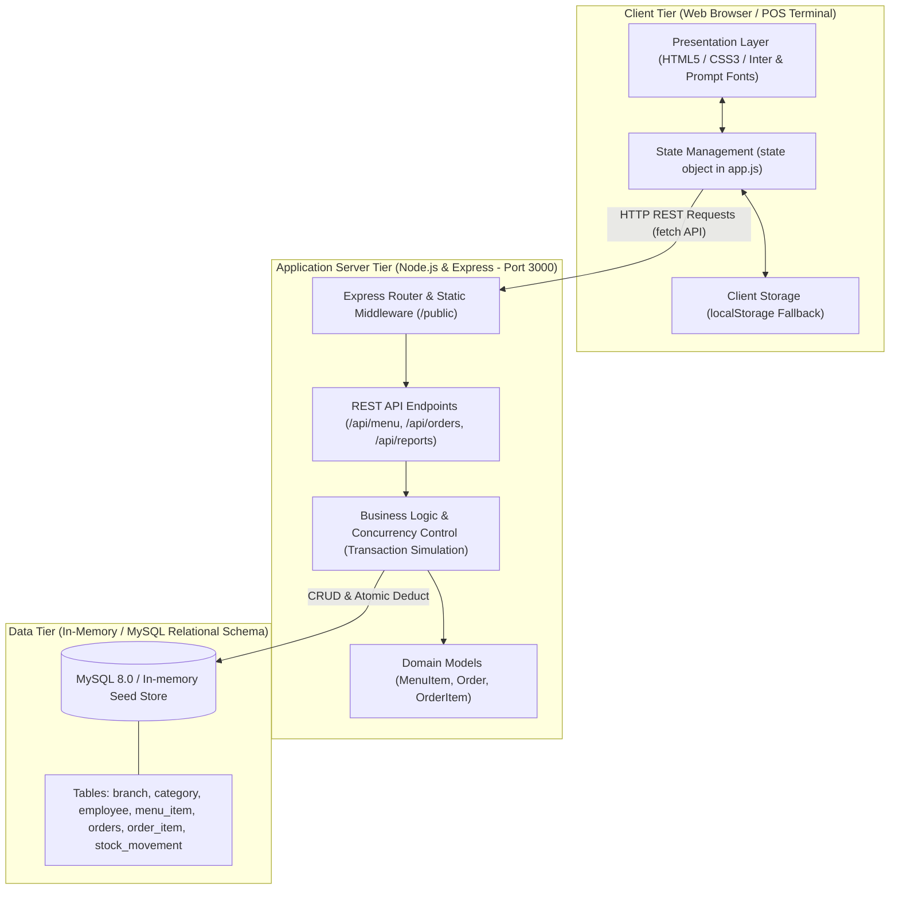
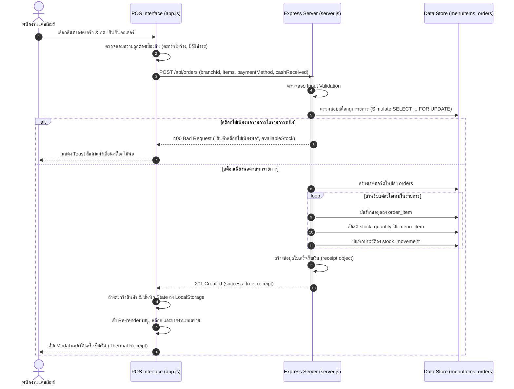
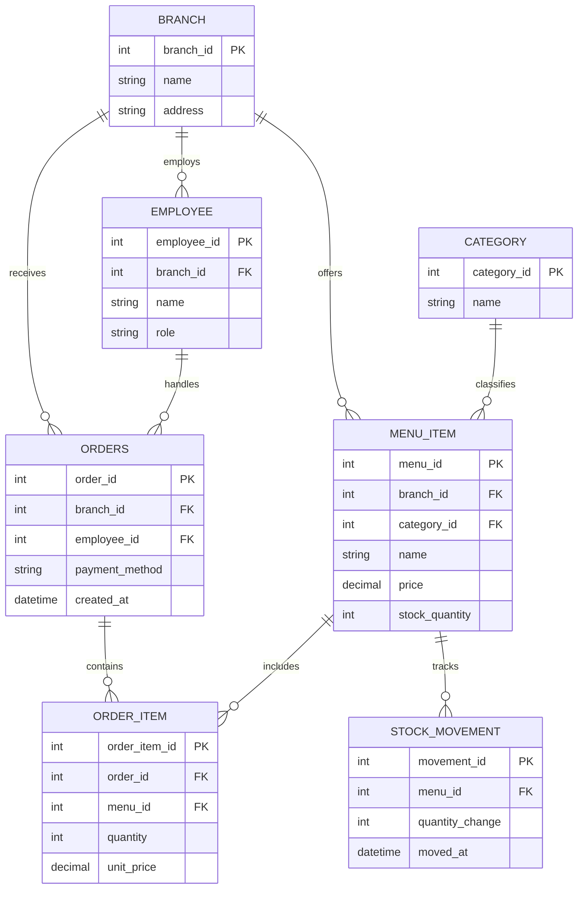

# เอกสารอธิบายระบบและคู่มือการใช้งานฉบับสมบูรณ์ (Project Summary & Technical Manual)
## โครงงานพัฒนาระบบบริหารจัดการร้าน Minions Cafe (Point of Sale & Management System)

> **รายวิชา:** 88734065 การวิเคราะห์และออกแบบระบบ (System Analysis and Design)  
> **ภาคการศึกษา:** ปลาย ปีการศึกษา 2568 คณะวิทยาการสารสนเทศ มหาวิทยาลัยบูรพา  
> **กลุ่มที่ 14:** Minions Cafe  
> **จัดทำโดย:** ทีมวิศวกรซอฟต์แวร์และผู้วิเคราะห์ระบบประจำกลุ่มที่ 14

---

## สารบัญ (Table of Contents)

1. [ภาพรวมของโครงการ (Project Overview)](#1-ภาพรวมของโครงการ-project-overview)
2. [เทคโนโลยีและเครื่องมือที่ใช้ (Technology Stack)](#2-เทคโนโลยีและเครื่องมือที่ใช้-technology-stack)
3. [โครงสร้างโปรเจกต์และบัญชีรายการไฟล์ (Project Structure & File Inventory)](#3-โครงสร้างโปรเจกต์และบัญชีรายการไฟล์-project-structure--file-inventory)
4. [สถาปัตยกรรมระบบ (System Architecture)](#4-สถาปัตยกรรมระบบ-system-architecture)
5. [ฟีเจอร์การทำงานและขั้นตอนการทำงาน (Features and Workflows)](#5-ฟีเจอร์การทำงานและขั้นตอนการทำงาน-features-and-workflows)
6. [การอธิบายซอร์สโค้ดอย่างละเอียด (Deep Code Explanation)](#6-การอธิบายซอร์สโค้ดอย่างละเอียด-deep-code-explanation)
7. [การออกแบบฐานข้อมูลและแบบจำลองข้อมูล (Database and Data Model)](#7-การออกแบบฐานข้อมูลและแบบจำลองข้อมูล-database-and-data-model)
8. [ส่วนเชื่อมต่อโปรแกรมประยุกต์และการบูรณาการ (API & Integration)](#8-ส่วนเชื่อมต่อโปรแกรมประยุกต์และการบูรณาการ-api--integration)
9. [คู่มือการติดตั้งและการเริ่มต้นระบบ (Installation & Setup Guide)](#9-คู่มือการติดตั้งและการเริ่มต้นระบบ-installation--setup-guide)
10. [คู่มือการใช้งานสำหรับผู้ใช้ (User Manual)](#10-คู่มือการใช้งานสำหรับผู้ใช้-user-manual)
11. [ความมั่นคงปลอดภัยและการจัดการข้อผิดพลาด (Security & Error Handling)](#11-ความมั่นคงปลอดภัยและการจัดการข้อผิดพลาด-security--error-handling)
12. [การทดสอบระบบและการแก้ปัญหา (Testing & Troubleshooting)](#12-การทดสอบระบบและการแก้ปัญหา-testing--troubleshooting)
13. [ข้อจำกัดที่ตรวจพบและแผนการพัฒนาในอนาคต (Known Limitations & Future Improvements)](#13-ข้อจำกัดที่ตรวจพบและแผนการพัฒนาในอนาคต-known-limitations--future-improvements)
14. [เอกสารอ้างอิงด่วนสำหรับเตรียมนำเสนอ (Quick Reference for Presentation)](#14-เอกสารอ้างอิงด่วนสำหรับเตรียมนำเสนอ-quick-reference-for-presentation)

---

## 1. ภาพรวมของโครงการ (Project Overview)

### 1.1 ชื่อโปรเจกต์
**Minions Cafe POS & Multi-Branch Management System**  
(ระบบจุดขายหน้าร้านและบริหารจัดการร้านกาแฟหลายสาขา มินเนียนส์ คาเฟ่)

### 1.2 โปรเจกต์นี้คืออะไร
Minions Cafe เป็นเว็บแอปพลิเคชันเชิงโต้ตอบสำหรับบริหารจัดการธุรกิจร้านกาแฟแบบครบวงจร ครอบคลุมตั้งแต่การสั่งซื้อเครื่องดื่มหน้าร้าน (Point of Sale - POS), การคำนวณเงินและออกใบเสร็จรับเงินแบบอิเล็กทรอนิกส์ (Thermal Digital Receipt), การตัดสต็อกและบันทึกประวัติการเคลื่อนไหวของวัตถุดิบสินค้าอัตโนมัติ (Automated Stock Deductions & Movements), การบริหารจัดการรายการเมนูและราคา, ตลอดจนแดชบอร์ดสรุปรายงานยอดขายแบบเรียลไทม์ (On-demand Sales Analytics) ที่รองรับการสลับและเปรียบเทียบข้อมูลระหว่างหลายสาขา (Multi-branch Architecture)

### 1.3 ปัญหาที่ต้องการแก้ไข (Problem Statement)
จากการศึกษากระบวนการเดิม (As-Is Process) ของร้านกาแฟ พบปัญหาคอขวดที่สร้างความเสียหายต่อธุรกิจดังนี้:
1. **Human Error ในการจดออเดอร์และคิดเงิน:** การใช้สมุดจดกระดาษทำให้ลายมืออ่านยาก บาริสต้าชงผิดพลาด และแคชเชียร์คิดราคารวมหรือเงินทอนผิดเฉลี่ย 3-5 รายการต่อวันในช่วงชั่วโมงเร่งด่วน
2. **ปัญหาสต็อกขาดมือโดยไม่รู้ตัว (Unnoticed Out-of-Stock):** เมล็ดกาแฟ ชา หรือขนมหมดระหว่างวันโดยที่พนักงานหน้าร้านไม่ทราบล่วงหน้า ส่งผลให้รับออเดอร์ลูกค้ามาแล้วไม่สามารถทำเครื่องดื่มได้ ทำให้ลูกค้าเสียความรู้สึกและร้านเสียโอกาสในการขาย
3. **ขาดข้อมูลการขายแบบทันท่วงที (Lack of Real-Time Sales Visibility):** เจ้าของร้านไม่สามารถดูยอดขายสรุปได้จนกว่าจะปิดร้านและรวมยอดจากสมุดบิล ซึ่งล่าช้าและไม่สามารถนำข้อมูลมาวางแผนสต็อกหรือประเมินเมนูขายดีได้ทันการณ์
4. **ความยุ่งยากในการขยายสาขา:** ร้านเริ่มมีการขยายสาขา (เช่น สาขาหลัก ม.บูรพา และสาขา 2 แหลมทอง) แต่ไม่มีระบบกลางในการแยกรายรับ สต็อก และเมนูตามแต่ละสาขา

### 1.4 วัตถุประสงค์ของโครงงาน (Project Objectives)
1. พัฒนาระบบ POS หน้าร้านที่คำนวณราคาย่อย ยอดรวม และเงินทอนได้ถูกต้อง 100% ภายในเสี้ยววินาที พร้อมพิมพ์ใบเสร็จรับเงินตามมาตรฐาน
2. พัฒนากลไกการตัดสต็อกสินค้าอัตโนมัติแบบทันที (Real-time Stock Deduction) พร้อมแสดงสถานะแจ้งเตือนสินค้าใกล้หมด (Low Stock Warning) และป้องกันไม่ให้สั่งซื้อสินค้าที่หมดสต็อกตั้งแต่หน้าจอแรก (Error Prevention ตามข้อกำหนด FR-11)
3. สร้างระบบรายงานยอดขายแบบ On-demand ที่อัปเดตข้อมูลทันทีที่มีออเดอร์ใหม่เกิดขึ้น (Real-time Consistency) พร้อมจัดอันดับเมนูขายดี และเปรียบเทียบยอดขายระหว่างสาขา
4. ประยุกต์ใช้หลักการวิเคราะห์และออกแบบระบบเชิงวัตถุ (OOAD), แบบจำลอง 4+1 View Model, ฐานข้อมูลเชิงสัมพันธ์ตามหลัก 3NF และแนวทางความมั่นคงปลอดภัยในการป้องกันปัญหา Race Condition และ IDOR

### 1.5 กลุ่มผู้ใช้งานเป้าหมาย (Target Users)
| บทบาทผู้ใช้ (Role) | บุคคลตัวแทน | หน้าที่ความรับผิดชอบหลักในระบบ |
|---|---|---|
| **พนักงานแคชเชียร์ / บาริสต้า (Cashier / Barista)** | สมชาย (สาขา 1), สมหญิง (สาขา 2) | รับออเดอร์หน้าร้าน, ปรับจำนวน, บันทึกวิธีชำระเงิน, ทอนเงิน, ออกใบเสร็จ |
| **ผู้จัดการร้าน / ฝ่ายคลังสินค้า (Branch Manager / Inventory Clerk)** | สมหญิง (Manager) | ปรับปรุงสต็อกวัตถุดิบ, แก้ไขราคาขาย, เพิ่มรายการเมนูใหม่, ตรวจสอบสินค้าใกล้หมด |
| **เจ้าของร้าน / ผู้บริหาร (Owner / Executive)** | เจ้าของกิจการ Minions Cafe | ตรวจสอบยอดขายรวม, วิเคราะห์สัดส่วนเมนูขายดี, เปรียบเทียบประสิทธิภาพการขายระหว่างสาขา 1 และสาขา 2 |

### 1.6 ความสามารถหลักของระบบ (Core Capabilities)
- **ระบบ POS อัจฉริยะ:** ค้นหาเมนูแบบพิมพ์ค้นหาทันที (Live Search), กรองตามหมวดหมู่ (กาแฟ, ชา, เบเกอรี่), ระบบตะกร้าสินค้าแบบโต้ตอบปรับจำนวนได้
- **ระบบคำนวณเงินและเงินทอน:** รองรับทั้งเงินสด (Cash) และ QR Code พร้อมเพย์ (QR PromptPay Simulation Modal)
- **ระบบออกใบเสร็จรับเงิน (Thermal Paper Receipt):** สวยงามตามมาตรฐานร้านกาแฟ พร้อมเลขที่ออเดอร์ วันเวลา สาขา พนักงาน และยอดรวม
- **ระบบตรวจสอบสต็อกแบบเชิงรุก (Proactive Inventory Control):**
  - แสดงสถานะสีเขียว (ปกติ), สีส้มเตือน (ต่ำกว่า 10 หน่วย), และสีเทา (สินค้าหมด)
  - ปิดปุ่มกดเพิ่มสินค้า (Disable button) ทันทีหากสต็อกเป็น 0 (ตามเงื่อนไข FR-11)
- **ระบบจัดการสต็อกและเมนู:** เพิ่มเมนูใหม่ แก้ไขราคา ปรับปรุงยอดสต็อก และลบเมนูได้สะดวกรวดเร็ว
- **ระบบรายงานยอดขายเรียลไทม์:** อัปเดต KPI ยอดขายรวม จำนวนออเดอร์ เมนูขายดี และกราฟเปรียบเทียบสาขาทันทีโดยไม่ต้องกด Refresh
- **สถาปัตยกรรมทำงานแบบ 2 ระบบในหนึ่งเดียว (Dual-Mode Architecture):** สามารถทำงานเชื่อมต่อ Backend Node.js Express API หรือรันแบบ Standalone ใน Web Browser ได้ 100% ผ่าน LocalStorage Fallback

### 1.7 ขอบเขตของระบบ (System Scope)
- ครอบคลุมการทำงานของร้านกาแฟ 2 สาขา (สาขา 1: ม.บูรพา และ สาขา 2: แหลมทอง)
- ครอบคลุมสินค้า 3 หมวดหมู่หลัก: กาแฟ (Coffee), ชา (Tea), และเบเกอรี่ (Bakery)
- บันทึกประวัติการขาย, รายการสินค้าในออเดอร์, และประวัติการเคลื่อนไหวสต็อก (Stock Movement)
- ทำงานบนเบราว์เซอร์มาตรฐานที่รองรับ HTML5, CSS3, ES6+

### 1.8 ข้อจำกัดที่ตรวจพบจากโค้ดจริง (Real Identified Constraints)
1. **การจำลองฐานข้อมูลใน Memory สำหรับเซิร์ฟเวอร์ Express:** ในไฟล์ `code/server.js` มีการประกาศตัวแปร Array ในหน่วยความจำ (`let menuItems`, `let orders`, `let orderItems`, `let stockMovements`) เพื่อให้สามารถรัน Demo ได้อย่างรวดเร็วโดยไม่ต้องพึ่งพา MySQL Daemon ภายนอก หากรีสตาร์ตเซิร์ฟเวอร์ ข้อมูลที่สร้างใหม่ระหว่างรันจะกลับสู่ค่าเริ่มต้น (Seed Data)
2. **ระบบชำระเงิน QR PromptPay เป็นรูปแบบ Simulation:** มีหน้าต่าง Pop-up แสดง QR Code พร้อมปุ่มจำลองการตอบรับจากธนาคาร ยังไม่ได้เชื่อมต่อ Webhook หรือ Payment Gateway จริงของธนาคารพาณิชย์
3. **ระบบสลับผู้ใช้งานผูกตามสาขา:** เมื่อสลับสาขาใน Dropdown มุมบนขวา ระบบจะเปลี่ยนชื่อพนักงานแคชเชียร์อัตโนมัติ (สาขา 1 เป็น "สมชาย", สาขา 2 เป็น "สมหญิง") ยังไม่มีระบบ Login/Password แยกบัญชีรายบุคคล

---

## 2. เทคโนโลยีและเครื่องมือที่ใช้ (Technology Stack)

| ส่วนของระบบ | เทคโนโลยี / เครื่องมือ | เวอร์ชันที่ตรวจพบ | บทบาทหน้าที่ในโปรเจกต์ | เหตุผลเชิงวิเคราะห์ |
|---|---|---|---|---|
| **Backend Runtime** | Node.js | v24.11.1 | สภาพแวดล้อมสำหรับประมวลผลโค้ดฝั่งเซิร์ฟเวอร์ | ประสิทธิภาพสูงด้วย Non-blocking I/O รองรับคำขอพร้อมกันได้ดี และใช้ภาษา JavaScript ร่วมกับฝั่ง Frontend ได้อย่างกลมกลืน |
| **Backend Framework** | Express.js | ^4.21.1 | โครงสร้างสำหรับสร้าง Web Server และ RESTful API Endpoints | มีความยืดหยุ่นสูง (Minimalist), มีมิดเดิลแวร์สำหรับจัดการ JSON body parser และ Static file serving ที่เสถียร |
| **CORS Middleware** | cors | ^2.8.5 | เปิดใช้งาน Cross-Origin Resource Sharing | อนุญาตให้ Web Client ที่รันต่าง Origin/Port สามารถเรียกใช้ API ได้โดยไม่ติดข้อจำกัดด้านความปลอดภัยของเบราว์เซอร์ |
| **Frontend Core** | HTML5 / Semantic Web | HTML5 Standard | โครงสร้างหน้าจอ Single Page Application (SPA) | แบ่งหน้าจอออกเป็น 3 Sections หลัก (`screen-pos`, `screen-menu`, `screen-report`) และ Modals สำหรับใบเสร็จและสต็อก |
| **Styling & Design** | Vanilla CSS3 (Custom Design System) | CSS3 | ระบบการจัดวางและตกแต่งหน้าตาด้วย CSS Variables, Grid และ Flexbox | ไม่พึ่งพา Framework ขนาดใหญ่ (เช่น Bootstrap หรือ Tailwind) ทำให้โหลดเร็ว รูปลักษณ์สไตล์มินิมอลคาเฟ่ อบอุ่น และปรับแต่ง Responsive ได้อิสระ |
| **Typography** | Google Fonts (Prompt, Inter, Space Mono) | Web Fonts | ตัวอักษรสำหรับอินเทอร์เฟซและฟอนต์ monospace สำหรับใบเสร็จ | เพิ่มความชัดเจนในการอ่านตัวเลขราคาสินค้า และให้ความรู้สึกเหมือนกระดาษใบเสร็จความร้อนจริง |
| **Client Scripting** | Vanilla JavaScript (ES6+) | ECMAScript 2020+ | ควบคุม State Management, DOM Manipulation, การคำนวณเงิน, LocalStorage และ Live Demo Sequence | ไม่ต้องใช้ Build Tools (Webpack/Vite) สามารถเปิดไฟล์รันบนเบราว์เซอร์ได้ทันที |
| **Database Design** | MySQL Relational Schema | 8.0 Standard DDL | โครงร่างฐานข้อมูลเชิงสัมพันธ์ 7 ตารางตามหลัก 3NF | รองรับ Foreign Key Integrity, แยกสาขาด้วย `branch_id` และมีตารางบันทึก Audit การเคลื่อนไหวสต็อก |
| **Domain Models** | JavaScript ES6 Classes | Object-Oriented | นิยาม `MenuItem`, `Order`, `OrderItem` พร้อมเมธอด `getSubtotal()` | สืบทอดการออกแบบเชิงวัตถุ (OOAD) จากสัปดาห์ที่ 6 สู่โค้ดจริง |
| **Package Manager** | npm | 11.6.2 | จัดการและติดตั้ง Library ภายนอก | ติดตั้ง Express และ CORS ผ่านไฟล์ `package.json` |

---

## 3. โครงสร้างโปรเจกต์และบัญชีรายการไฟล์ (Project Structure & File Inventory)

### 3.1 แผนผังโครงสร้างโฟลเดอร์และไฟล์จริงในโปรเจกต์

```text
D:\System Analysis\Minions\
├── .gitignore                         # ไฟล์ระบุรายการที่ไม่ต้องการติดตามลง Git ของโฟลเดอร์หลัก
├── README.md                          # เอกสารแนะนำโปรเจกต์, รายชื่อสมาชิกกลุ่ม 14, และขั้นตอนรัน Live Demo
├── sum.md                             # [ไฟล์นี้] เอกสารอธิบายระบบและคู่มือการใช้งานฉบับสมบูรณ์
├── ans.md                             # เอกสารรวมคำถาม-ตอบสำหรับเตรียมสอบปากเปล่าและป้องกันโครงงาน
├── code\                              # โฟลเดอร์ซอร์สโค้ดของระบบ Minions Cafe POS
│   ├── .gitignore                     # รายการละเว้นไฟล์ของ Node.js (node_modules, logs)
│   ├── package.json                   # การตั้งค่า Dependencies และคำสั่งเริ่มระบบ (npm start / dev)
│   ├── package-lock.json              # บันทึกเวอร์ชันที่แน่นอนของแพ็กเกจที่ติดตั้ง
│   ├── server.js                      # Backend Express Web Server, REST API และ Seed Data
│   ├── app.js                         # ซอร์สโค้ด JavaScript ฝั่ง Client (จัดรูปแบบมาตรฐาน)
│   ├── index.html                     # โครงสร้างหน้าเว็บหลักแบบ Single Page Application
│   ├── style.css                      # ชุดสไตล์ชีตหลัก ดีไซน์ระบบ และเลย์เอาต์ใบเสร็จ
│   ├── models\                        # โมเดลเชิงวัตถุ (Domain Class Models)
│   │   ├── menuModel.js               # คลาส MenuItem นิยามฟิลด์สอดคล้องกับตาราง menu_item
│   │   └── orderModel.js              # คลาส Order และ OrderItem พร้อมเมธอดคำนวณ getSubtotal()
│   └── public\                        # โฟลเดอร์สำหรับบริการไฟล์ Static ของ Express Server
│       ├── app.js                     # สคริปต์ Client ที่ Express ให้บริการ
│       ├── index.html                 # หน้าเว็บที่ Express ให้บริการแก่เบราว์เซอร์
│       └── style.css                  # สไตล์ชีตที่ Express ให้บริการ
├── docs\                              # เอกสารรายงานประกอบการวิเคราะห์และออกแบบระบบ 15 สัปดาห์
│   ├── As-Is.jpg                      # แผนภาพกระบวนการทำงานเดิมก่อนมีระบบ
│   ├── to-be.png                      # แผนภาพกระบวนการทำงานใหม่หลังนำระบบไปใช้
│   ├── usecase-diagram.jpg            # Use Case Diagram รวมของระบบ Minions Cafe
│   ├── class.mmd / object.mmd         # โค้ด Mermaid สำหรับวาด Class และ Object Diagram
│   ├── test.mmd                       # โค้ดทดสอบ Mermaid Diagram
│   ├── wk01-team-charter.md           # เอกสารสัปดาห์ที่ 1: กฎบัตรทีม และองค์ประกอบ 6 ด้านของระบบสารสนเทศ
│   ├── wk02-feasibility-report.md     # เอกสารสัปดาห์ที่ 2: การศึกษาความเป็นไปได้ (TELOS) และกระบวนการ BPMN
│   ├── wk03-requirements.md           # เอกสารสัปดาห์ที่ 3: สัมภาษณ์ความต้องการ, FR-01 ถึง FR-12, และที่มาของ FR-11
│   ├── wk04-user-stories.md           # เอกสารสัปดาห์ที่ 4: User Stories US-01 ถึง US-05 และ Acceptance Criteria
│   ├── wk06-class-diagram.png         # ภาพ Class Diagram ทางการของระบบ
│   ├── wk06-object-diagram.png        # ภาพ Object Diagram ทางการของระบบ
│   ├── wk07-schema.sql                # สคริปต์ภาษา SQL DDL สำหรับสร้างฐานข้อมูล 7 ตาราง
│   ├── wk07-er-diagram.png            # ภาพ Entity-Relationship Diagram
│   ├── wk09-sequence-diagram.png      # ภาพ Sequence Diagram แสดงการสั่งซื้อและตัดสต็อก
│   ├── wk10-input-output-design.md    # เอกสารสัปดาห์ที่ 10: การออกแบบ Input/Output และใบเสร็จ
│   ├── wk10-input-output.png          # ภาพการออกแบบ Input/Output
│   ├── wk10-srs.md                    # เอกสารข้อกำหนดความต้องการซอฟต์แวร์ฉบับสมบูรณ์ (SRS)
│   ├── wk10-wireframe.md              # เอกสารอธิบายการออกแบบ Mid-Fi Wireframe 3 หน้าจอ
│   ├── wk10-wireframe.png             # ภาพรวมการออกแบบ Wireframe
│   ├── wk11-architecture.md           # เอกสารสัปดาห์ที่ 11: สถาปัตยกรรมระบบ 4+1 View Model
│   ├── wk11-physical-view.png         # ภาพ Physical Deployment View
│   ├── wk11-development-view.png      # ภาพ Development Component View
│   ├── wk12-usability-testing.md      # เอกสารสัปดาห์ที่ 12: รายงานการทดสอบ Usability และการปรับแก้ UI-01 ถึง UI-04
│   ├── wk14-quality-review.md         # เอกสารสัปดาห์ที่ 14: การตรวจสอบคุณภาพโค้ด และการแก้ Race Condition
│   ├── presentation-slides-canva.md   # โครงร่างสไลด์นำเสนอและบทพูดสำหรับสมาชิก 5 คน
│   ├── minions-cafe-presentation.pptx # สไลด์นำเสนอ PowerPoint ฉบับสมบูรณ์
│   ├── project-report.md / .docx / .pdf # รายงานสรุปโครงงานรวมเล่มฉบับสมบูรณ์ 3 รูปแบบ
│   ├── ai-disclosure\                 # บันทึกแบบฟอร์มการเปิดเผยการใช้งาน AI ตลอดภาคเรียน
│   │   ├── wk05-ai-disclosure.md      # แบบฟอร์มสัปดาห์ที่ 5 (Git & Branching Strategy)
│   │   ├── wk09-ai-disclosure.md      # แบบฟอร์มสัปดาห์ที่ 9 (Sequence Diagram & API Specifications)
│   │   ├── wk10-ai-disclosure.md      # แบบฟอร์มสัปดาห์ที่ 10 (Input/Output & Wireframe)
│   │   └── wk13-ai-disclosure.md      # แบบฟอร์มสัปดาห์ที่ 13 (System Integration & E2E Testing)
│   └── images\                        # โฟลเดอร์สำรองรูปภาพแผนภาพและหลักฐานทั้งหมด
└── scratch\                           # โฟลเดอร์สคริปต์ช่วยงานอัตโนมัติ
    └── generate_pptx.py               # สคริปต์ภาษา Python สำหรับสร้างสไลด์ PowerPoint อัตโนมัติ
```

### 3.2 บัญชีรายการไฟล์ (File Inventory Table)

| ลำดับ | เส้นทางไฟล์ (Relative Path) | ประเภทไฟล์ | หน้าที่ความรับผิดชอบ | สถานะการตรวจสอบ |
|:---:|---|---|---|:---:|
| 1 | `code/server.js` | JavaScript (Node.js) | Backend API Server, จำลอง In-memory DB, ตรวจสอบ Transaction & IDOR | ตรวจสอบโค้ดครบ 702 บรรทัด |
| 2 | `code/models/menuModel.js` | JavaScript Class | Domain Model คลาส MenuItem | ตรวจสอบโค้ดครบ 13 บรรทัด |
| 3 | `code/models/orderModel.js` | JavaScript Class | Domain Model คลาส Order, OrderItem พร้อม method getSubtotal() | ตรวจสอบโค้ดครบ 31 บรรทัด |
| 4 | `code/app.js` | JavaScript (Browser) | ควบคุม State, ตะกร้าสินค้า, การสลับหน้า, การคำนวณเงิน, โหมดจำลอง Demo | ตรวจสอบโค้ดครบ 1,099 บรรทัด |
| 5 | `code/index.html` | HTML5 Document | โครงสร้าง UI หน้าจอ POS, จัดการเมนู, รายงาน และ Modals | ตรวจสอบโค้ดครบ 511 บรรทัด |
| 6 | `code/style.css` | CSS Stylesheet | ดีไซน์ระบบ, ตกแต่งปุ่ม, การ์ดเมนู, กล่องตะกร้า, กระดาษใบเสร็จ | ตรวจสอบโค้ดครบ 1,153 บรรทัด |
| 7 | `code/public/app.js` | JavaScript (Browser) | สคริปต์ที่ส่งผ่าน Express Static Server | ตรวจสอบโค้ดครบ 821 บรรทัด |
| 8 | `code/public/index.html` | HTML5 Document | เอกสาร HTML ที่ Express ส่งผ่าน Static Server | ตรวจสอบความสอดคล้องกับไฟล์หลัก |
| 9 | `code/public/style.css` | CSS Stylesheet | สไตล์ชีตที่ Express ส่งผ่าน Static Server | ตรวจสอบความสอดคล้องกับไฟล์หลัก |
| 10 | `code/package.json` | JSON Config | บันทึก Metadata ของโปรเจกต์, คำสั่ง npm, dependencies | ตรวจสอบความถูกต้อง |
| 11 | `docs/wk07-schema.sql` | SQL DDL | คำสั่งสร้างฐานข้อมูลเชิงสัมพันธ์ MySQL 7 ตาราง | ตรวจสอบคำสั่ง SQL ครบทุกบรรทัด |
| 12 | `docs/wk10-srs.md` | Markdown Document | ข้อกำหนดความต้องการซอฟต์แวร์ (SRS) ทางการ | ตรวจสอบและเทียบเคียงกับโค้ดจริง |
| 13 | `docs/wk11-architecture.md` | Markdown Document | อธิบายสถาปัตยกรรม 4+1 View Model และการเปรียบเทียบ Monolith | ตรวจสอบและเทียบเคียงกับโค้ดจริง |
| 14 | `docs/wk14-quality-review.md`| Markdown Document | รายงานผลการรีวิวโค้ด, การวิเคราะห์ Race Condition และ IDOR | ตรวจสอบและเทียบเคียงกับโค้ดจริง |
| 15 | `scratch/generate_pptx.py` | Python Script | สคริปต์สร้างสไลด์นำเสนอด้วยโมดูล python-pptx | ตรวจสอบโครงสร้างคำสั่ง |

---

## 4. สถาปัตยกรรมระบบ (System Architecture)

### 4.1 ภาพรวมสถาปัตยกรรม (High-Level Architecture)
ระบบ Minions Cafe ได้รับการออกแบบตามแนวทาง **Monolithic Architecture ที่จัดโครงสร้างภายในแบบ Layered Architecture (Monolithic + Layered)** เพื่อความคล่องตัวในการพัฒนาและบำรุงรักษาสำหรับทีมงาน 5 คนภายใน 1 ภาคการศึกษา โดยมีจุดเด่นในการออกแบบแบบ Dual-Mode ที่ Client สามารถทำงานได้ทั้งแบบมี Backend API หรือรันบน Browser แบบ Standalone:



### 4.2 การแบ่งชั้นการทำงาน (Layered Separation of Concerns)
1. **Presentation Layer (`index.html`, `style.css`):**  
   รับผิดชอบการแสดงผลแบบ Single Page Application แบ่งเป็น 3 ส่วนหน้าจอหลัก ได้แก่ หน้า POS, หน้าจัดการเมนู, และหน้ารายงานยอดขาย โดยมีหน้าต่าง Modal แยกเป็นเอกเทศสำหรับใบเสร็จรับเงิน, การสแกน QR Code, การปรับปรุงสต็อก และการเพิ่มเมนูใหม่
2. **Client State & Controller Layer (`app.js`):**  
   จัดการตัวแปร State กลาง (`state` object) ซึ่งเก็บสาขาที่เลือก (`branchId`), หมวดหมู่ที่กำลังกรอง (`activeCategory`), คำค้นหา (`searchQuery`), รายการในตะกร้า (`cart`), และประวัติออเดอร์ (`orders`) ฟังก์ชันในส่วนนี้จะคำนวณราคารวมสด, ตรวจสอบสต็อกก่อนอนุญาตให้เพิ่มลงตะกร้า, และจัดการแสดงผล Toast Notification
3. **API & Routing Layer (`server.js`):**  
   ใช้ Express.js รับส่งข้อมูลผ่าน HTTP Methods (GET, POST, PUT) ด้วยรูปแบบ JSON และทำหน้าที่ส่งมอบไฟล์หน้าเว็บสถิตผ่าน `express.static(path.join(__dirname, 'public'))`
4. **Business Logic & Concurrency Control (`server.js`):**  
   ตรวจสอบความถูกต้องของข้อมูล (Input Validation), ป้องกันการแก้ไขข้ามสาขา (IDOR Protection), และจำลองกระบวนการทำงานของ Database Transaction เพื่อตรวจสอบและตัดสต็อกแบบ Atomic
5. **Domain Class Models (`models/menuModel.js`, `models/orderModel.js`):**  
   นิยาม Class เชิงวัตถุเพื่อกำหนดโครงสร้างข้อมูลให้สอดคล้องกับ Database Schema และมีเมธอดสำหรับการคำนวณทางธุรกิจ เช่น `OrderItem.getSubtotal()`

### 4.3 แผนภาพกระบวนการสั่งซื้อและตัดสต็อก (Sequence Diagram: Order to Stock Flow)
กระบวนการยืนยันออเดอร์และการตัดสต็อกได้รับการออกแบบตามสเปกของสัปดาห์ที่ 9 และ 14 เพื่อให้ข้อมูลเงินและสต็อกมีความถูกต้องสมบูรณ์เสมอ:



---

## 5. ฟีเจอร์การทำงานและขั้นตอนการทำงาน (Features and Workflows)

### 5.1 ฟีเจอร์ที่ 1: ระบบจุดขายหน้าร้าน (Point of Sale - POS Screen)
- **หน้าที่:** ให้พนักงานแคชเชียร์รับออเดอร์เครื่องดื่มและขนม คำนวณเงินสด/เงินทอน และบันทึกคำสั่งซื้อ
- **จุดเริ่มต้น:** เปิดระบบที่หน้าแรก หรือคลิกแท็บ `🛒 POS รับออเดอร์`
- **การประมวลผล:**
  1. ดึงรายการเมนูเฉพาะของสาขาที่เลือกมาแสดงผลในการ์ดเมนู
  2. กรองเมนูตามคำค้นหาในช่อง Search Box หรือแท็บหมวดหมู่ (กาแฟ, ชา, เบเกอรี่)
  3. แสดงป้ายสถานะสต็อก: ปกติ (สีเขียว), ต่ำกว่าเกณฑ์ (สีส้ม), และสินค้าหมด (สีเทา)
  4. คลิกปุ่ม `+` บนการ์ดเมนูเพื่อเพิ่มสินค้าเข้าสู่ตะกร้า
  5. ระบบตะกร้าคำนวณราคาย่อยและยอดรวมสุทธิแบบเรียลไทม์ทันที สามารถกดปุ่ม `[-]` หรือ `[+]` เพื่อปรับจำนวน หรือกด `✕` เพื่อลบรายการ
  6. เลือกวิธีชำระเงิน:
     - **เงินสด (Cash):** กรอกจำนวนเงินที่รับมาในช่อง "รับเงินสดมา" ระบบจะคำนวณ "เงินทอน" ให้ทันที
     - **QR พร้อมเพย์ (QR):** กดยืนยันออเดอร์จะมีหน้าต่าง Pop-up แสดง QR Code พร้อมยอดเงิน ให้กดปุ่มจำลองการจ่ายเงินสำเร็จ
- **เงื่อนไขและข้อจำกัด:**
  - หากรายการเมนูใดมีสต็อกเป็น 0 ปุ่ม `+` จะถูก Disable และไม่สามารถคลิกได้ (สอดคล้องกับข้อกำหนด **FR-11**)
  - ไม่สามารถปรับจำนวนในตะกร้าให้เกินกว่าจำนวนสต็อกคงเหลือที่มีอยู่จริงได้
  - ปุ่ม "ยืนยันออเดอร์" จะถูกปิดการใช้งาน (Disabled) หากตะกร้าว่างเปล่า
- **ไฟล์และฟังก์ชันที่เกี่ยวข้อง:** `code/index.html` (บรรทัด 56-150), `code/app.js` (`renderMenu()`, `addToCart()`, `updateCartQty()`, `submitOrder()`, `calculateChange()`)

### 5.2 ฟีเจอร์ที่ 2: ระบบพิมพ์และออกใบเสร็จรับเงินดิจิทัล (Official Thermal Receipt Modal)
- **หน้าที่:** สร้างและแสดงผลใบเสร็จรับเงินมาตรฐานหลังจากการสั่งซื้อสำเร็จ
- **จุดเริ่มต้น:** เกิดขึ้นทันทีหลังเรียกใช้ฟังก์ชัน `finalizeOrderExecution()` หรือเมื่อคลิกปุ่ม "ดูใบเสร็จ" ในประวัติออเดอร์ล่าสุด
- **การประมวลผล:**
  1. นำข้อมูลออเดอร์มาสร้างเลขที่ใบเสร็จตามรูปแบบ `ORD-YYYYMMDD-XXX`
  2. แสดงชื่อสาขา, วันที่และเวลาที่ทำรายการ, ชื่อพนักงานแคชเชียร์
  3. แสดงตารางแจกแจงรายการสินค้า จำนวน และราคารวม
  4. แสดงยอดรวมสุทธิ วิธีชำระเงิน จำนวนเงินที่รับ และเงินทอน
  5. มีปุ่ม `🖨 พิมพ์ใบเสร็จ` เพื่อเรียกคำสั่ง `window.print()` สำหรับสั่งพิมพ์ไปยังเครื่องพิมพ์ใบเสร็จความร้อน
- **ไฟล์และฟังก์ชันที่เกี่ยวข้อง:** `code/index.html` (บรรทัด 309-379), `code/app.js` (`displayReceiptModal()`, `printReceiptArea()`)

### 5.3 ฟีเจอร์ที่ 3: ระบบจัดการเมนูและควบคุมสต็อก (Menu & Inventory Management)
- **หน้าที่:** ตรวจสอบสต็อกวัตถุดิบ ปรับปรุงจำนวนสินค้า ปรับราคาขาย และเพิ่มเมนูใหม่ประจำสาขา
- **จุดเริ่มต้น:** คลิกแท็บ `📋 จัดการเมนู & สต็อก`
- **การประมวลผล:**
  1. แสดงตารางรายการเมนูทั้งหมดของสาขาที่เลือก พร้อมรูปไอคอน ชื่อ หมวดหมู่ ราคา สต็อกคงเหลือ และสถานะ
  2. **ปรับปรุงสต็อกด่วน (Quick Stock Adjustment):** คลิกปุ่ม `⚡ ปรับสต็อก` เพื่อเปิด Modal ระบุจำนวนสต็อกใหม่ แล้วบันทึกค่าลงระบบทันที
  3. **แก้ไขราคา (Edit Price):** คลิกปุ่ม `✏️ แก้ไขราคา` ระบบจะแสดงกล่อง Prompt ให้ระบุราคาใหม่ โดยตรวจสอบเงื่อนไขต้องเป็นตัวเลขมากกว่า 0
  4. **เพิ่มเมนูใหม่ (Add New Menu):** คลิกปุ่ม `+ เพิ่มเมนูใหม่` กรอกชื่อ หมวดหมู่ ไอคอน ราคา และสต็อกเริ่มต้น ระบบจะคำนวณ ID เมนูใหม่ให้อัตโนมัติและเพิ่มลงในฐานข้อมูลของสาขานั้น
  5. **ลบเมนู (Delete Menu):** คลิกปุ่ม `🗑 ลบ` มีกล่องยืนยันการลบเพื่อป้องกันการกดพลาด
- **ไฟล์และฟังก์ชันที่เกี่ยวข้อง:** `code/index.html` (บรรทัด 155-186, 431-497), `code/app.js` (`renderMenuManagement()`, `openStockModal()`, `saveStockAdjustment()`, `promptEditPrice()`, `submitNewMenu()`, `deleteMenuItem()`)

### 5.4 ฟีเจอร์ที่ 4: ระบบรายงานยอดขายเรียลไทม์ (On-demand Sales Analytics Report)
- **หน้าที่:** แสดงสรุปยอดขาย ประเมินผลการดำเนินงาน และวิเคราะห์ข้อมูลการขายสำหรับเจ้าของร้าน
- **จุดเริ่มต้น:** คลิกแท็บ `📊 รายงานยอดขาย`
- **การประมวลผล:**
  1. คำนวณการ์ดสรุป KPI ได้แก่:
     - ยอดขายรวมสุทธิ (Total Revenue - บาท)
     - จำนวนออเดอร์ทั้งหมด (Total Orders - รายการ)
     - เมนูขายดีอันดับ 1 (Best Seller Menu พร้อมจำนวนแก้วที่ขายได้)
     - จำนวนแก้วรวมที่จำหน่ายได้ทั้งหมด (Total Cups Sold)
  2. แสดงตารางแจกแจงยอดขายรายเมนู จัดเรียงลำดับจากเมนูที่มียอดขายสูงสุดลงมา
  3. แสดงแถบกราฟแท่งเปรียบเทียบสัดส่วนยอดขายระหว่าง **สาขา 1 (ม.บูรพา)** และ **สาขา 2 (แหลมทอง)**
  4. แสดงรายการออเดอร์ล่าสุด 5 รายการ พร้อมปุ่มเปิดดูใบเสร็จย้อนหลัง
  5. คลิกปุ่ม `📥 ส่งออก CSV` เพื่อดาวน์โหลดรายงานออกมาเป็นไฟล์สเปรดชีต `.csv` สำหรับเปิดใน Microsoft Excel
- **ไฟล์และฟังก์ชันที่เกี่ยวข้อง:** `code/index.html` (บรรทัด 191-303), `code/app.js` (`renderSalesReport()`, `exportReportCSV()`)

### 5.5 ฟีเจอร์ที่ 5: การรองรับหลายสาขา (Multi-Branch Selector Consistency)
- **หน้าที่:** ควบคุมการแสดงผลและแยกฐานข้อมูลระหว่างสาขาอย่างเคร่งครัด
- **จุดเริ่มต้น:** กล่องเลือกสาขา (Dropdown) บริเวณมุมบนขวาของ Header ที่ปรากฏเหมือนกันในทุกหน้าจอ
- **การประมวลผล:**
  1. เมื่อผู้ใช้เลือกสลับสาขา (เช่น จากสาขา 1 เป็นสาขา 2)
  2. ระบบจะอัปเดตตัวแปร `state.branchId`
  3. ปรับเปลี่ยนชื่อพนักงานแคชเชียร์ที่แสดงด้านบนทันที (สาขา 1: "สมชาย", สาขา 2: "สมหญิง")
  4. ล้างรายการสินค้าในตะกร้า (`state.cart = []`) โดยอัตโนมัติ เพื่อป้องกันปัญหาการสั่งซื้อสินค้าข้ามสาขาหรือข้อมูลสต็อกไม่สอดคล้องกัน (IDOR & State Consistency)
  5. ทำการโหลดและเรนเดอร์ข้อมูลเมนู ตารางสต็อก และรายงานยอดขายของสาขานั้นใหม่ทั้งหมด
- **ไฟล์และฟังก์ชันที่เกี่ยวข้อง:** `code/app.js` (`onBranchChange()`)

---

## 6. การอธิบายซอร์สโค้ดอย่างละเอียด (Deep Code Explanation)

### 6.1 ไฟล์ `code/models/menuModel.js`
- **เส้นทาง:** `code/models/menuModel.js` (ความยาว 13 บรรทัด)
- **หน้าที่:** โมเดลข้อมูลเชิงวัตถุสำหรับตัวแทนสินค้าและวัตถุดิบ (MenuItem Domain Entity)
- **โครงสร้างคลาส:**
  ```javascript
  class MenuItem {
      constructor(menu_id, branch_id, category_id, name, price, stock_quantity) {
          this.menu_id = menu_id;
          this.branch_id = branch_id;
          this.category_id = category_id;
          this.name = name;
          this.price = price;
          this.stock_quantity = stock_quantity;
      }
  }
  module.exports = { MenuItem };
  ```
- **คำอธิบายตัวแปรและคุณสมบัติ:**
  - `menu_id`: รหัสประจำตัวของเมนู (Primary Key)
  - `branch_id`: รหัสสาขาที่เมนูนี้สังกัด (Foreign Key อ้างอิงตาราง `branch`)
  - `category_id`: รหัสหมวดหมู่สินค้า 1=กาแฟ, 2=ชา, 3=เบเกอรี่ (Foreign Key อ้างอิงตาราง `category`)
  - `name`: ชื่อเมนูสินค้า (เช่น "Latte (ลาเต้ร้อน/เย็น)")
  - `price`: ราคาจำหน่ายต่อหน่วย (บาท)
  - `stock_quantity`: จำนวนสต็อกคงเหลือในคลังของสาขานั้น

### 6.2 ไฟล์ `code/models/orderModel.js`
- **เส้นทาง:** `code/models/orderModel.js` (ความยาว 31 บรรทัด)
- **หน้าที่:** โมเดลข้อมูลเชิงวัตถุสำหรับตัวแทนคำสั่งซื้อ (`Order`) และรายการสินค้าในคำสั่งซื้อ (`OrderItem`)
- **โครงสร้างคลาสและการคำนวณ:**
  ```javascript
  class Order {
      constructor(order_id, branch_id, employee_id, payment_method, created_at) {
          this.order_id = order_id;
          this.branch_id = branch_id;
          this.employee_id = employee_id;
          this.payment_method = payment_method;
          this.created_at = created_at;
      }
      // หมายเหตุ: total_amount ไม่ถูกจัดเก็บในตาราง orders เพราะเป็นค่าที่คำนวณได้ (derived value) 
      // ตามหลัก 3NF จึงไม่มี field นี้
  }

  class OrderItem {
      constructor(order_item_id, order_id, menu_id, quantity, unit_price) {
          this.order_item_id = order_item_id;
          this.order_id = order_id;
          this.menu_id = menu_id;
          this.quantity = quantity;
          this.unit_price = unit_price;
      }

      getSubtotal() {
          return this.quantity * this.unit_price;
      }
  }
  module.exports = { Order, OrderItem };
  ```
- **จุดสำคัญที่ต้องเข้าใจ (Critical Architectural Insight):**  
  ในคลาส `Order` สังเกตว่าจะ **ไม่มีตัวแปร `total_amount`** เนื่องจากตามหลักการออกแบบฐานข้อมูล Third Normal Form (3NF) ข้อมูลยอดรวมถือเป็นค่าที่อนุมานหรือคำนวณได้ (Derived Attribute) จากผลรวมของ `OrderItem.quantity * OrderItem.unit_price` การไม่จัดเก็บฟิลด์นี้ในตารางหลักช่วยป้องกันปัญหาข้อมูลขัดแย้งกัน (Data Inconsistency) เมื่อมีการปรับปรุงรายการสินค้าภายหลัง

### 6.3 ไฟล์ `code/server.js` (Backend API & Concurrency Control)
- **เส้นทาง:** `code/server.js` (ความยาว 702 บรรทัด)
- **หน้าที่:** เป็น Web Server หลักที่สร้างด้วย Express.js ให้บริการ RESTful API, เก็บ In-Memory Data Store จำลองตารางทั้ง 7 ตาราง, และควบคุมความถูกต้องของข้อมูล (Validation, Transaction, IDOR)

#### ฟังก์ชันสำคัญใน `code/server.js`:
1. **การตั้งค่าเซิร์ฟเวอร์และ Static Middleware (บรรทัด 1-13):**
   ```javascript
   const app = express();
   const PORT = process.env.PORT || 3000;
   app.use(cors());
   app.use(express.json());
   app.use(express.static(path.join(__dirname, "public")));
   ```
   กำหนดพอร์ตเริ่มต้นที่ 3000 (หรืออ่านจาก Environment Variable) และให้บริการไฟล์ HTML/JS/CSS จากโฟลเดอร์ `public`

2. **`GET /api/menu` (การดึงข้อมูลเมนูพร้อมคำนวณสถานะสต็อก - บรรทัด 282-311):**
   - **พารามิเตอร์ (Query Parameters):** `branchId`, `categoryId`, `search`
   - **การทำงาน:** กรองสินค้าตามสาขา และหมวดหมู่ จากนั้นแปลงฟิลด์ให้เป็น camelCase ตาม API Contract พร้อมคำนวณคุณสมบัติพิเศษ:
     - `isLowStock`: เป็นจริงเมื่อ `stock_quantity > 0 && stock_quantity < 10`
     - `isOutOfStock`: เป็นจริงเมื่อ `stock_quantity <= 0`
   - **ผลลัพธ์ (Response):** รายการเมนูในรูปแบบ JSON Array

3. **`PUT /api/menu/:id` (การแก้ไขเมนูพร้อมระบบป้องกัน IDOR - บรรทัด 352-387):**
   - **พารามิเตอร์ (URL Param & Body):** `id` (menu_id), `branchId`, `price`, `stockQuantity`, `name`
   - **ตรรกะความปลอดภัย (IDOR Protection):**
     ```javascript
     if (branchId && item.branch_id !== parseInt(branchId)) {
       return res.status(403).json({
         error: "ปฏิเสธการเข้าถึง: ไม่สามารถแก้ไขข้อมูลข้ามสาขาได้ (IDOR Protection)"
       });
     }
     ```
     ตรวจสอบว่าเมนูที่ต้องการแก้ไขนั้นเป็นของสาขาที่ส่งคำขอมาจริงหรือไม่ หากไม่ตรงกันจะส่ง HTTP Status `403 Forbidden` ป้องกันไม่ให้สาขาหนึ่งแก้ไขข้อมูลของอีกสาขาหนึ่ง

4. **`POST /api/orders` (การสร้างออเดอร์และตัดสต็อกแบบจำลอง Transaction - บรรทัด 390-535):**
   - **พารามิเตอร์ (Request Body):**
     - `branchId`: รหัสสาขา
     - `employeeId`: รหัสพนักงาน
     - `paymentMethod`: วิธีชำระเงิน ("Cash" หรือ "QR")
     - `items`: อาร์เรย์ของ `{ menuId, quantity }`
     - `cashReceived`: ยอดเงินสดที่รับมา
   - **ตรรกะการทำงานทีละขั้น (Step-by-Step Logic):**
     1. ตรวจสอบความถูกต้องของ Input (Validation) หากข้อมูลไม่ครบส่ง `400 Bad Request`
     2. **ขั้นตอนจำลอง `SELECT ... FOR UPDATE` (Phase 1: Verification):** วนลูปตรวจสอบสต็อกของสินค้าทุกชิ้นในตะกร้าก่อนตัดสต็อกจริง หากพบว่าสินค้าชิ้นใดสต็อกไม่พอ (`stock_quantity < requestedQty`) จะยกเลิกคำขอทันทีโดยไม่มีการตัดสต็อกสินค้าชิ้นอื่นเลย (Atomic Rollback)
     3. ตรวจสอบเงินสดที่รับมาว่าเพียงพอกับยอดรวมหรือไม่
     4. **ขั้นตอนตัดสต็อกและบันทึกข้อมูล (Phase 2: Execution & Commit):**
        - บันทึกออบเจกต์คำสั่งซื้อใหม่ลงใน `orders`
        - วนลูปตัดลด `stock_quantity` ใน `menuItems`
        - บันทึกรายการสินค้าลงใน `orderItems`
        - บันทึกประวัติการตัดสต็อกลงใน `stockMovements` (`quantity_change: -rec.quantity`)
     5. สร้างและส่งมอบข้อมูลใบเสร็จรับเงิน (Receipt) ที่มีหมายเลขรันตามวันเวลา ส่งกลับในสถานะ `201 Created`

5. **`GET /api/reports/sales` (การสรุปรายงานยอดขาย - บรรทัด 538-602):**
   - **พารามิเตอร์ (Query Parameters):** `branchId`, `from`, `to`
   - **การทำงาน:** กรองออเดอร์ตามสาขา แล้วนำไอเทมที่เกี่ยวข้องมาหาผลรวมยอดขาย (`totalSales`), ยอดแก้วรวม (`totalQuantity`), จัดกลุ่มยอดขายรายเมนู (`menuStats`), คำนวณหาเมนูที่ขายดีที่สุด (`bestSeller`), และส่งคืนประวัติออเดอร์ย้อนหลัง 10 รายการ

6. **`POST /api/reset` (การรีเซ็ตข้อมูลตัวอย่างสำหรับ Demo - บรรทัด 605-698):**
   - รีเซ็ตอาร์เรย์ `menuItems` และ `orders` กลับสู่ค่าเริ่มต้นเริ่มต้นตาม Seed Data ช่วยให้ผู้ทดสอบสามารถกดเริ่มต้นการสาธิตใหม่ได้ตลอดเวลา

### 6.4 ไฟล์ `code/app.js` (Client-Side Controller & UI Logic)
- **เส้นทาง:** `code/app.js` (ความยาว 1,099 บรรทัด)
- **หน้าที่:** ควบคุมการโต้ตอบของผู้ใช้บนเบราว์เซอร์, จัดการ State ของแอปพลิเคชัน, เชื่อมต่อ API และจัดการ Fallback เมื่อออฟไลน์

#### กลไกและฟังก์ชันสำคัญใน `code/app.js`:
1. **การตรวจสอบสภาพแวดล้อม (Dual-Mode Execution - บรรทัด 239-250):**
   ```javascript
   async function checkBackendApi() {
     try {
       const res = await fetch("/api/menu?branchId=" + state.branchId);
       if (res.ok) {
         state.isOnlineServer = true;
         console.log("Connected to Minions Cafe Express Backend API");
       }
     } catch (e) {
       state.isOnlineServer = false;
       console.log("Running in Standalone Browser Client Mode");
     }
   }
   ```
   ระบบจะทดลองยิง HTTP Request ไปยัง Express Backend หากเซิร์ฟเวอร์เปิดอยู่จะทำงานในโหมด Online แต่หากผู้ใช้ดับเบิลคลิกไฟล์ `index.html` ตรงๆ โดยไม่เปิดเซิร์ฟเวอร์ ระบบจะเปลี่ยนสถานะเป็น Standalone Browser Mode และจัดการ State ผ่านหน่วยความจำและ `localStorage` ทันที

2. **ฟังก์ชัน `addToCart(menuId)` (บรรทัด 390-427):**
   - รับพารามิเตอร์ `menuId`
   - ค้นหาเมนูใน `state.menu` ตาม `menuId` และ `state.branchId`
   - **การตรวจสอบความปลอดภัย (Error Prevention):**
     - ตรวจสอบว่าสินค้าหมดสต็อกหรือไม่ หาก `stockQuantity <= 0` จะแสดง Toast แจ้งเตือนและไม่อนุญาตให้เพิ่ม
     - ตรวจสอบว่าจำนวนสินค้าในตะกร้าเดิมบวก 1 เกินกว่าสต็อกที่มีหรือไม่ หากเกินจะปฏิเสธการเพิ่ม
   - เพิ่มรายการสินค้าลงในอาร์เรย์ `state.cart` และเรียกฟังก์ชัน `renderCart()`

3. **ฟังก์ชัน `updateCartQty(menuId, delta)` (บรรทัด 429-450):**
   - รับ `delta` เป็น `+1` หรือ `-1`
   - หากยอดคงเหลือกลายเป็น `0` จะทำการลบสินค้านั้นออกจากตะกร้าโดยอัตโนมัติ
   - หากสั่งซื้อเกินกว่าสต็อกของเมนูนั้น จะปฏิเสธและแจ้งเตือน

4. **ฟังก์ชัน `submitOrder()` และ `finalizeOrderExecution()` (บรรทัด 560-661):**
   - ตรวจสอบว่าตะกร้ามีสินค้าหรือไม่
   - หากเลือกวิธีชำระเงินเป็น QR Code จะสั่งเปิด `qr-modal`
   - หากเลือกเงินสด จะตรวจสอบจำนวนเงินที่รับมาว่ามากกว่ายอดรวมหรือไม่
   - เมื่อยืนยันเสร็จสมบูรณ์ จะทำการตัดสต็อกในตัวแปร `state.menu`, บันทึกประวัติลง `state.orders`, บันทึกลง `localStorage`, เปิดหน้าต่างใบเสร็จ `displayReceiptModal()`, และสั่งอัปเดตการแสดงผลทุกหน้าจอ

5. **ฟังก์ชันสาธิตระบบ `demoStep(step)` (บรรทัด 1013-1068):**
   - ควบคุมการสาธิตระบบสำหรับการนำเสนอ 5-8 นาทีตามลำดับ 5 ขั้นตอน:
     - ขั้นตอนที่ 1: เปิดหน้าจอ POS และตัวเลือกสาขา
     - ขั้นตอนที่ 2: สั่งซื้อ Latte + Espresso + Croissant ยอดรวม ฿135.00 อัตโนมัติ
     - ขั้นตอนที่ 3: ชำระเงินสด 200 บาท ทอนเงิน 65 บาท ตัดสต็อกและเปิดใบเสร็จ
     - ขั้นตอนที่ 4: สลับไปหน้ารายงานยอดขาย แสดงผลยอดขายรวมและรายการขายที่อัปเดตทันที
     - ขั้นตอนที่ 5: สาธิตกรณีสต็อกเป็น 0 (เมนู Lemon Tea) เพื่อพิสูจน์การป้องกันความผิดพลาดตามข้อกำหนด FR-11

---

## 7. การออกแบบฐานข้อมูลและแบบจำลองข้อมูล (Database and Data Model)

### 7.1 โครงสร้างฐานข้อมูลเชิงสัมพันธ์ 7 ตาราง (Relational Database Schema)
อ้างอิงจากไฟล์สคริปต์ [docs/wk07-schema.sql](file:///d:/System%20Analysis/Minions/docs/wk07-schema.sql) และ ER Diagram ของโปรเจกต์:



### 7.2 รายละเอียดตาราง คอลัมน์ และข้อกำหนด (Data Dictionary)

#### 1. ตาราง `branch` (ข้อมูลสาขา)
- `branch_id`: `INT AUTO_INCREMENT PRIMARY KEY` — รหัสสาขา
- `name`: `VARCHAR(100) NOT NULL` — ชื่อสาขา (เช่น "สาขา 1 (สาขาหลัก - ม.บูรพา)")
- `address`: `VARCHAR(255)` — ที่อยู่สถานที่ตั้งของสาขา

#### 2. ตาราง `category` (หมวดหมู่สินค้า)
- `category_id`: `INT AUTO_INCREMENT PRIMARY KEY` — รหัสหมวดหมู่
- `name`: `VARCHAR(50) NOT NULL` — ชื่อหมวดหมู่ (กาแฟ, ชา, เบเกอรี่)

#### 3. ตาราง `employee` (ข้อมูลพนักงาน)
- `employee_id`: `INT AUTO_INCREMENT PRIMARY KEY` — รหัสพนักงาน
- `branch_id`: `INT NOT NULL` — รหัสสาขาที่สังกัด (`FOREIGN KEY REFERENCES branch(branch_id)`)
- `name`: `VARCHAR(100) NOT NULL` — ชื่อ-สกุลพนักงาน
- `role`: `VARCHAR(20) NOT NULL` — ตำแหน่งหน้าที่ (Cashier, Manager, Barista)

#### 4. ตาราง `menu_item` (รายการเมนูและสต็อก)
- `menu_id`: `INT AUTO_INCREMENT PRIMARY KEY` — รหัสเมนู
- `branch_id`: `INT NOT NULL` — รหัสสาขาที่เป็นเจ้าของเมนู (`FOREIGN KEY REFERENCES branch(branch_id)`)
- `category_id`: `INT NOT NULL` — รหัสหมวดหมู่ (`FOREIGN KEY REFERENCES category(category_id)`)
- `name`: `VARCHAR(100) NOT NULL` — ชื่อรายการเครื่องดื่มหรือขนม
- `price`: `DECIMAL(10,2) NOT NULL` — ราคาต่อหน่วย
- `stock_quantity`: `INT DEFAULT 0` — จำนวนสต็อกคงเหลือในสาขานั้น

#### 5. ตาราง `orders` (ข้อมูลหัวใบเสร็จคำสั่งซื้อ)
- `order_id`: `INT AUTO_INCREMENT PRIMARY KEY` — รหัสคำสั่งซื้อ
- `branch_id`: `INT NOT NULL` — รหัสสาขาที่ทำรายการ (`FOREIGN KEY REFERENCES branch(branch_id)`)
- `employee_id`: `INT NOT NULL` — รหัสพนักงานแคชเชียร์ผู้รับออเดอร์ (`FOREIGN KEY REFERENCES employee(employee_id)`)
- `payment_method`: `VARCHAR(20) NOT NULL` — รูปแบบการชำระเงิน ('Cash', 'QR')
- `created_at`: `DATETIME NOT NULL DEFAULT CURRENT_TIMESTAMP` — วันและเวลาที่สั่งซื้อ
*(หมายเหตุ: ไม่มีคอลัมน์ `total_amount` ตามหลัก Third Normal Form)*

#### 6. ตาราง `order_item` (รายการสินค้าในคำสั่งซื้อ)
- `order_item_id`: `INT AUTO_INCREMENT PRIMARY KEY` — รหัสรายการสินค้าในออเดอร์
- `order_id`: `INT NOT NULL` — รหัสคำสั่งซื้อ (`FOREIGN KEY REFERENCES orders(order_id)`)
- `menu_id`: `INT NOT NULL` — รหัสเมนูสินค้า (`FOREIGN KEY REFERENCES menu_item(menu_id)`)
- `quantity`: `INT NOT NULL` — จำนวนที่สั่งซื้อ (> 0)
- `unit_price`: `DECIMAL(10,2) NOT NULL` — ราคาต่อหน่วย ณ ขณะที่ทำการขาย

#### 7. ตาราง `stock_movement` (ประวัติการเคลื่อนไหวสต็อก)
- `movement_id`: `INT AUTO_INCREMENT PRIMARY KEY` — รหัสบันทึกการเคลื่อนไหว
- `menu_id`: `INT NOT NULL` — รหัสเมนูสินค้า (`FOREIGN KEY REFERENCES menu_item(menu_id)`)
- `quantity_change`: `INT NOT NULL` — จำนวนที่เปลี่ยนแปลง (ค่าติดลบแสดงการขายออก เช่น -2, ค่าบวกแสดงการรับเข้าสต็อก)
- `moved_at`: `DATETIME NOT NULL DEFAULT CURRENT_TIMESTAMP` — วันและเวลาที่เกิดการเคลื่อนไหว

### 7.3 การอธิบายการออกแบบตามหลักการปรับมาตรฐานฐานข้อมูล (Normalization to 3NF)
1. **First Normal Form (1NF):**  
   ทุกแอตทริบิวต์ในทุกตารางเก็บค่าเชิงอะตอม (Atomic Values) ไม่มีการเก็บรายการสินค้าแบบ Comma-separated list ในตาราง `orders` แต่แยกออกมาเป็นตาราง `order_item`
2. **Second Normal Form (2NF):**  
   ไม่มี Partial Functional Dependency โดยทุกคอลัมน์ที่ไม่ใช่คีย์หลักขึ้นตรงกับ Primary Key ทั้งหมดของตารางนั้น เช่น ใน `order_item` ฟิลด์ `quantity` และ `unit_price` ขึ้นตรงกับ `order_item_id`
3. **Third Normal Form (3NF):**  
   ไม่มี Transitive Functional Dependency โดยฟิลด์ที่คำนวณได้จากฟิลด์อื่น (Derived Attribute) เช่น **`total_amount` ในคำสั่งซื้อ ถูกตัดออกจากตาราง `orders`** เพราะสามารถคำนวณได้จาก `SUM(quantity * unit_price)` ของตาราง `order_item` เสมอ ทำให้โครงสร้างฐานข้อมูลมีความสอดคล้องสูงสุดและไม่เกิดภาวะข้อมูลขัดแย้ง

---

## 8. ส่วนเชื่อมต่อโปรแกรมประยุกต์และการบูรณาการ (API & Integration)

ระบบให้บริการ RESTful API ผ่าน Express Server ที่พอร์ต `3000` โดยมีรายละเอียด Endpoint ดังนี้:

### 8.1 รายการ REST API Endpoints ทั้งหมด

| Method | Endpoint | วัตถุประสงค์ | Parameters / Request Body | Response ตัวอย่าง | รหัสสถานะ HTTP |
|---|---|---|---|---|:---:|
| `GET` | `/api/branches` | ดึงรายชื่อสาขาทั้งหมด | ไม่มี | `[{"branch_id":1, "name":"สาขา 1 (ม.บูรพา)"}]` | 200 OK |
| `GET` | `/api/categories` | ดึงรายชื่อหมวดหมู่สินค้า | ไม่มี | `[{"category_id":1, "name":"กาแฟ (Coffee)"}]` | 200 OK |
| `GET` | `/api/menu` | ดึงรายการเมนูตามสาขาและคำค้น | Query: `branchId`, `categoryId`, `search` | `[{"menuId":1, "name":"Latte", "price":45, "stockQuantity":12, "isLowStock":false}]` | 200 OK |
| `POST` | `/api/menu` | เพิ่มเมนูใหม่ในสาขา | Body: `{branchId, categoryId, name, price, stockQuantity, icon}` | `{"success":true, "message":"เพิ่มเมนูสำเร็จ", "menuItem":{...}}` | 201 Created<br>400 Bad Request |
| `PUT` | `/api/menu/:id` | ปรับปรุงราคา/สต็อก (พร้อมตรวจ IDOR) | Param: `id`<br>Body: `{branchId, price, stockQuantity, name}` | `{"success":true, "message":"อัปเดตข้อมูลเมนูสำเร็จ"}` | 200 OK<br>403 Forbidden<br>404 Not Found |
| `POST` | `/api/orders` | บันทึกออเดอร์และตัดสต็อก (Transaction) | Body: `{branchId, employeeId, paymentMethod, items:[{menuId, quantity}], cashReceived}` | `{"success":true, "orderId":105, "receipt":{...}}` | 201 Created<br>400 Bad Request<br>404 Not Found |
| `GET` | `/api/reports/sales`| ดึงข้อมูลสรุปยอดขายแยกสาขา | Query: `branchId`, `from`, `to` | `{"totalSales":405, "totalOrders":4, "bestSeller":{...}, "menuBreakdown":[...]}` | 200 OK |
| `POST` | `/api/reset` | รีเซ็ตข้อมูลตั้งต้นสำหรับการสาธิต | ไม่มี | `{"success":true, "message":"รีเซ็ตข้อมูลตัวอย่างเรียบร้อย"}` | 200 OK |

### 8.2 ตัวอย่าง Payload ของ `POST /api/orders`
**Request Body:**
```json
{
  "branchId": 1,
  "employeeId": 1,
  "paymentMethod": "Cash",
  "cashReceived": 200.00,
  "items": [
    { "menuId": 1, "quantity": 1 },
    { "menuId": 2, "quantity": 1 },
    { "menuId": 8, "quantity": 1 }
  ]
}
```

**Response Body (201 Created):**
```json
{
  "success": true,
  "message": "บันทึกออเดอร์และตัดสต็อกสำเร็จ",
  "orderId": 105,
  "receipt": {
    "receiptNo": "ORD-20261030-105",
    "orderId": 105,
    "branchId": 1,
    "branchName": "สาขา 1 (สาขาหลัก - ม.บูรพา)",
    "branchAddress": "169 ถ.ลงหาดบางแสน ต.แสนสุข อ.เมือง ชลบุรี",
    "employeeName": "สมชาย พนักงานขาย",
    "createdAt": "2026-10-30 12:45:00",
    "items": [
      { "menuId": 1, "name": "Latte (ลาเต้ร้อน/เย็น)", "quantity": 1, "unitPrice": 45.0, "subtotal": 45.0 },
      { "menuId": 2, "name": "Espresso (เอสเปรสโซ่)", "quantity": 1, "unitPrice": 35.0, "subtotal": 35.0 },
      { "menuId": 8, "name": "Butter Croissant (ครัวซองต์เนยสด)", "quantity": 1, "unitPrice": 55.0, "subtotal": 55.0 }
    ],
    "totalAmount": 135.0,
    "paymentMethod": "Cash",
    "cashReceived": 200.0,
    "changeDue": 65.0
  }
}
```

---

## 9. คู่มือการติดตั้งและการเริ่มต้นระบบ (Installation & Setup Guide)

### 9.1 ความต้องการขั้นต่ำของระบบ (Prerequisites)
- **ระบบปฏิบัติการ:** Windows 10/11, macOS, หรือ Linux
- **Node.js:** เวอร์ชัน 18.0.0 ขึ้นไป (ตรวจสอบพบในระบบคือ `v24.11.1`)
- **Package Manager:** npm (v9.0.0 ขึ้นไป)
- **เว็บเบราว์เซอร์:** Google Chrome, Microsoft Edge, Mozilla Firefox, หรือ Safari เวอร์ชันใหม่

### 9.2 ขั้นตอนการติดตั้ง Dependencies
เปิด Command Prompt หรือ PowerShell แล้วพิมพ์คำสั่งดังนี้:

```bash
# 1. ย้ายตำแหน่งเข้าสู่โฟลเดอร์ code
cd "d:\System Analysis\Minions\code"

# 2. ติดตั้งโมดูล dependencies (express และ cors)
npm install
```

### 9.3 การเริ่มต้นระบบ (Starting the Application)

#### วิธีที่ 1: รันผ่าน Node.js Express Server (แนะนำสำหรับนำเสนอและทดสอบ API)
```bash
# รันคำสั่งเริ่มต้นเซิร์ฟเวอร์
npm start
```
เมื่อเซิร์ฟเวอร์ทำงานสำเร็จ จะปรากฏข้อความบนหน้าต่าง Console:
```text
Minions Cafe POS Server running at http://localhost:3000
```
เปิดเว็บเบราว์เซอร์แล้วเข้าไปที่ URL: **`http://localhost:3000`**

#### วิธีที่ 2: รันแบบ Standalone Browser Client (กรณีไม่ต้องติดตั้ง Node.js หรือใช้นำเสนอด่วน)
1. ไปที่โฟลเดอร์ `d:\System Analysis\Minions\code\`
2. ดับเบิลคลิกที่ไฟล์ **`index.html`** เพื่อเปิดใช้งานบนเบราว์เซอร์ได้ทันที
3. ระบบจะทำงานใน Standalone Client Mode โดยอัตโนมัติ โดยมีข้อมูล Seed Data ในตัวและบันทึกประวัติลง `localStorage` ครบถ้วน 100%

### 9.4 วิธีหยุดและรีสตาร์ตระบบ
- หากต้องการหยุดเซิร์ฟเวอร์ ให้กดปุ่ม `Ctrl + C` ในหน้าต่าง Terminal ที่รันคำสั่งอยู่ แล้วกด `Y` เพื่อยืนยัน
- หากต้องการเริ่มต้นใหม่ ให้พิมพ์ `npm start` อีกครั้ง

### 9.5 ปัญหาที่อาจพบและแนวทางแก้ไข (Troubleshooting)
1. **ปัญหาพอร์ตชนกัน (`Error: listen EADDRINUSE: address already in use :::3000`):**
   - *สาเหตุ:* มีโปรเซสอื่นหรือ Node.js ตัวเดิมกำลังรันค้างอยู่ที่พอร์ต 3000
   - *วิธีแก้:* เปลี่ยนพอร์ตผ่าน Environment Variable เช่นใน PowerShell:  
     `$env:PORT=3001; npm start` หรือปิดโปรเซสเดิมผ่าน Task Manager
2. **หน้าเว็บไม่แสดงเมนูเมื่อรันแบบ Standalone:**
   - *สาเหตุ:* แคชของ `localStorage` ในเบราว์เซอร์อาจบันทึกสถานะผิดพลาด
   - *วิธีแก้:* กดปุ่ม `🔄 รีเซ็ต Demo` ที่มุมล่างขวาของหน้าจอ เพื่อล้างแคชและคืนค่าเริ่มต้น

---

## 10. คู่มือการใช้งานสำหรับผู้ใช้ (User Manual)

### 10.1 บทบาทพนักงานแคชเชียร์: การรับออเดอร์และคิดเงิน (POS Screen)
1. **เลือกสาขา:** ตรวจสอบ Dropdown `📍 สาขา:` ที่มุมบนขวา ให้ตรงกับสาขาที่ตนเองปฏิบัติงาน (สาขา 1 ม.บูรพา หรือ สาขา 2 แหลมทอง)
2. **ค้นหาและเลือกเมนู:**
   - สามารถพิมพ์ชื่อเครื่องดื่มในช่องค้นหา `🔍 ค้นหาเมนูเครื่องดื่ม หรือขนม...`
   - หรือคลิกปุ่มหมวดหมู่ `☕ กาแฟ`, `🍵 ชา`, `🥐 เบเกอรี่`
3. **เพิ่มรายการลงตะกร้า:**
   - คลิกปุ่ม `+` บนการ์ดเมนูที่ลูกค้าต้องการ รายการจะไปปรากฏในแผงตะกร้าสินค้าทางขวา
   - หากต้องการเพิ่มหรือลดจำนวน ให้กดปุ่ม `[-]` หรือ `[+]` ในตารางตะกร้า
   - หากต้องการลบรายการทิ้ง ให้กดปุ่ม `✕`
4. **เลือกวิธีชำระเงิน:**
   - หากลูกค้าจ่าย **เงินสด (Cash):** ให้คลิกเลือกปุ่มเงินสด แล้วพิมพ์ยอดเงินที่รับจากลูกค้าลงในช่อง "รับเงินสดมา" ระบบจะแสดงเงินทอนอัตโนมัติ
   - หากลูกค้าจ่าย **QR พร้อมเพย์ (QR):** ให้คลิกเลือกปุ่ม QR พร้อมเพย์
5. **ยืนยันออเดอร์และพิมพ์ใบเสร็จ:**
   - คลิกปุ่มสีเขียว `✓ ยืนยันออเดอร์`
   - หากเลือก QR Code จะมีหน้าต่าง QR พร้อมเพย์ขึ้นมา ให้กดปุ่ม "จำลองลูกค้าสแกนจ่ายสำเร็จ"
   - หน้าต่างใบเสร็จรับเงิน (Official Receipt) จะแสดงขึ้นมาอย่างสวยงาม สามารถกดปุ่ม `🖨 พิมพ์ใบเสร็จ` เพื่อพิมพ์ออกเครื่องพิมพ์ความร้อน หรือกด "ปิดหน้าต่าง" เพื่อรับลูกค้ารายถัดไป

### 10.2 บทบาทผู้จัดการร้าน: การจัดการเมนูและสต็อก (Menu Management Screen)
1. คลิกแท็บ `📋 จัดการเมนู & สต็อก` บนแถบเมนูด้านบน
2. **การปรับสต็อกวัตถุดิบด่วน:**
   - มองหารายการสินค้าที่ต้องการในตาราง
   - คลิกปุ่ม `⚡ ปรับสต็อก`
   - กรอกจำนวนสต็อกคงเหลือจริงในกล่องข้อความ แล้วคลิก "บันทึกสต็อก"
3. **การแก้ไขราคาขาย:**
   - คลิกปุ่ม `✏️ แก้ไขราคา` ในแถวของเมนูที่ต้องการ
   - ระบุราคาใหม่ในกล่องข้อความ แล้วกดยืนยัน ราคาใหม่จะอัปเดตไปยังหน้าจอ POS ทันที
4. **การเพิ่มเมนูใหม่ประจำสาขา:**
   - คลิกปุ่ม `+ เพิ่มเมนูใหม่` ที่มุมบนขวา
   - ระบุชื่อเมนู, หมวดหมู่, สัญลักษณ์ไอคอน, ราคาต่อหน่วย และสต็อกเริ่มต้น
   - คลิก "บันทึกเมนู" เมนูใหม่จะเปิดให้ขายในสาขานั้นทันที

### 10.3 บทบาทเจ้าของร้าน: การวิเคราะห์รายงานยอดขาย (Sales Report Screen)
1. คลิกแท็บ `📊 รายงานยอดขาย`
2. **อ่านค่าตัวชี้วัดหลัก (KPIs):**
   - ดูยอดขายรวมสุทธิ (฿), จำนวนออเดอร์, และจำนวนแก้วรวม
   - ดูการ์ด "เมนูขายดีอันดับ 1" ว่าเมนูใดได้รับความนิยมสูงสุด
3. **วิเคราะห์สถิติรายเมนู:**
   - เลื่อนดูตาราง "แจกแจงยอดขายตามเมนู" เพื่อดูว่าเมนูใดทำรายได้สูงที่สุด
4. **เปรียบเทียบระหว่างสาขา:**
   - ดูแถบกราฟแท่ง "เปรียบเทียบยอดขาย 2 สาขา" ด้านขวา เพื่อดูสัดส่วนยอดขายระหว่างสาขา 1 (ม.บูรพา) เทียบกับสาขา 2 (แหลมทอง)
5. **ดาวน์โหลดรายงาน:**
   - คลิกปุ่ม `📥 ส่งออก CSV` เพื่อดาวน์โหลดข้อมูลการขายไปเปิดวิเคราะห์ต่อในโปรแกรม Excel

---

## 11. ความมั่นคงปลอดภัยและการจัดการข้อผิดพลาด (Security & Error Handling)

จากการตรวจสอบซอร์สโค้ดจริงเทียบกับผลการประเมินในสัปดาห์ที่ 14 ([docs/wk14-quality-review.md](file:///d:/System%20Analysis/Minions/docs/wk14-quality-review.md)) ระบบได้วางมาตรการความมั่นคงปลอดภัยไว้ดังนี้:

### 11.1 การป้องกันปัญหาการแย่งชิงทรัพยากร (Race Condition & Concurrency Control)
- **จุดที่พบความเสี่ยงเดิม:** ในกระบวนการสั่งซื้อ หากพนักงาน 2 คนกดยืนยันออเดอร์สินค้าชิ้นสุดท้ายพร้อมกัน คำสั่งอ่านค่าสต็อกเดิมอาจอ่านได้ค่า 1 เท่ากันทั้งคู่ และทำการตัดสต็อกจนกลายเป็นติดลบ (-1)
- **มาตรการแก้ไขที่นำมาใช้:**
  - นำแนวคิด **Database Transaction** ร่วมกับการล็อกแถวข้อมูล **`SELECT ... FOR UPDATE`** มาใช้ในกระบวนการสั่งซื้อ
  - ใน `code/server.js` (บรรทัด 406-446) มีการทำ **Atomic Pre-check**: ระบบจะวนลูปตรวจสอบและล็อกสต็อกสินค้าทุกตัวในตะกร้าก่อน หากมีแม้แต่รายการเดียวที่สต็อกไม่พอ ระบบจะปฏิเสธคำขอและสั่ง Rollback ทันทีโดยไม่มีการตัดสต็อกสินค้าชิ้นอื่น

### 11.2 การป้องกันการอ้างอิงวัตถุโดยตรงที่ไม่ปลอดภัย (IDOR Prevention)
- **จุดที่พบความเสี่ยงเดิม:** การส่งคำขอ `PUT /api/menu/:id` เพื่อปรับราคาหรือสต็อก อาจถูกผู้ใช้สาขาหนึ่งส่ง `id` เมนูของอีกสาขาหนึ่งเพื่อแอบแก้ไขข้อมูลข้ามสาขา
- **มาตรการแก้ไขที่นำมาใช้:**
  - ใน `code/server.js` (บรรทัด 361-369) เพิ่มการตรวจสอบความสอดคล้องระหว่าง `branchId` ของผู้ใช้กับ `branch_id` ที่เป็นเจ้าของเมนู:
    ```javascript
    if (branchId && item.branch_id !== parseInt(branchId)) {
      return res.status(403).json({
        error: "ปฏิเสธการเข้าถึง: ไม่สามารถแก้ไขข้อมูลข้ามสาขาได้ (IDOR Protection)"
      });
    }
    ```

### 11.3 การป้องกันความผิดพลาดในระดับส่วนประสานผู้ใช้ (UI Error Prevention & FR-11)
- **ตามหลัก Usability Engineering:** ป้องกันไม่ให้เกิดข้อผิดพลาด ดีกว่าปล่อยให้เกิดแล้วค่อยแจ้งเตือน
- **มาตรการในโค้ด:**
  - หาก `stockQuantity === 0` ระบบจะปิดการใช้งานปุ่ม `+` (`disabled`) ทันที พร้อมแสดงป้าย "✕ สินค้าหมด" บนหน้าจอ POS ป้องกันไม่ให้ผู้ใช้เลือกสินค้าที่ไม่มีของ
  - หากตะกร้าสินค้าว่างเปล่า ปุ่ม "ยืนยันออเดอร์" จะถูก Disabled ไม่สามารถคลิกได้

### 11.4 การตรวจสอบความถูกต้องของข้อมูลนำเข้า (Input Validation)
- ตรวจสอบชนิดข้อมูล (Data Types) ของราคาและจำนวนสต็อก ต้องเป็นตัวเลขมากกว่า 0
- ตรวจสอบวิธีชำระเงิน ต้องเป็นค่าที่กำหนดเท่านั้น (`['Cash', 'QR']`)
- ป้องกันการกรอกสต็อกติดลบในหน้าปรับปรุงสต็อก

---

## 12. การทดสอบระบบและการแก้ปัญหา (Testing & Troubleshooting)

### 12.1 ผลการทดสอบการใช้งานจริงกับผู้ใช้ (Usability Testing Results)
อ้างอิงจากรายงานในสัปดาห์ที่ 12 ([docs/wk12-usability-testing.md](file:///d:/System%20Analysis/Minions/docs/wk12-usability-testing.md)) ทีมงานได้ทำการทดสอบแบบ Task-Based Testing ร่วมกับ Think-Aloud Protocol กับกลุ่มผู้ใช้งานตัวแทน โดยมีผลการทดสอบดังนี้:

| หมายเลขงาน (Task) | สถานการณ์ทดสอบ | เวลาเฉลี่ยที่ใช้ | ผลลัพธ์ | ปัญหาที่ค้นพบและการแก้ไข |
|---|---|:---:|:---:|---|
| **Task 1: Happy Path POS** | สั่งซื้อ Latte 1 แก้ว จ่ายเงินสด และออกใบเสร็จ | 42 วินาที | **ผ่าน (Success)** | เดิมปุ่มยืนยันออเดอร์กลืนกับพื้นหลัง → ปรับแก้เป็นปุ่มสีเขียวเด่นชัด (Emerald Accent) |
| **Task 2: Out of Stock & Validation** | พยายามสั่งซื้อ Espresso เกินสต็อกคงเหลือที่มีอยู่ 8 แก้ว | 35 วินาที | **ผ่าน (Success)** | พบว่าเมนูสต็อกหมดเดิมยังคลิกได้ → แก้ไขโค้ดเพิ่มเงื่อนไข **FR-11** ปิดปุ่มทันทีที่สต็อกเป็น 0 |
| **Task 3: Sales Reporting** | ตรวจสอบยอดขายรวมและเมนูขายดีหลังขายเสร็จ | 28 วินาที | **ผ่าน (Success)** | ผู้ใช้ประทับใจที่ข้อมูลอัปเดตแบบเรียลไทม์ทันทีโดยไม่ต้องรีเฟรชหน้าจอ |

### 12.2 การทดสอบการเชื่อมต่อระบบแบบครบวงจร (End-to-End System Integration)
ในสัปดาห์ที่ 13 ได้ทำการทดสอบ E2E Test ครอบคลุมการทำงานตั้งแต่การคลิกสั่งซื้อหน้าเว็บ การส่งคำขอผ่าน API การตัดสต็อก และการสะท้อนข้อมูลกลับสู่หน้าจอรายงาน:
- ทดสอบการสั่งซื้อ Latte (฿45) + Espresso (฿35) + Croissant (฿55) รวม ฿135.00 สต็อกของทั้ง 3 รายการในระบบลดลงอย่างละ 1 หน่วยถูกต้องสมบูรณ์
- หน้ารายงานยอดขายคำนวณรายรับเพิ่มขึ้น ฿135.00 และเพิ่มจำนวนออเดอร์ขึ้น 1 ทันที

---

## 13. ข้อจำกัดที่ตรวจพบและแผนการพัฒนาในอนาคต (Known Limitations & Future Improvements)

| หมวดหมู่ | สิ่งที่มีอยู่แล้วในระบบปัจจุบัน | สิ่งที่พบว่าเป็นข้อจำกัด / ปัญหา | สิ่งที่เสนอให้ปรับปรุงในอนาคต |
|---|---|---|---|
| **การจัดเก็บข้อมูล (Data Persistence)** | โค้ด Backend มี In-Memory Seed Store และ Client มี LocalStorage Fallback | เมื่อปิดโปรเซส Node.js ข้อมูลออเดอร์ใหม่จะหายไปหากไม่ได้เชื่อมกับ MySQL จริง | เชื่อมต่อ Database Connection Pool เข้ากับ MySQL Server ถาวรผ่านไดรเวอร์ `mysql2/promise` |
| **ระบบการชำระเงิน (Payment Gateway)** | มีหน้าต่าง Pop-up สแกน QR PromptPay พร้อมปุ่มจำลองการตอบรับจากธนาคาร | ยังไม่ได้ส่งคำขอไปยังระบบ API ของธนาคารจริง | เชื่อมต่อ Payment Gateway API (เช่น Omise หรือ GB Prime Pay) เพื่อรับ Webhook ยืนยันยอดเงินจริง |
| **การยืนยันตัวตน (Authentication)** | มีการระบุบทบาทพนักงาน (Cashier, Manager) ตามสาขา | ยังไม่มีระบบ Login ด้วยรหัสผ่านและ JWT Token | พัฒนาระบบ Authentication และ Role-Based Access Control (RBAC) ด้วย bcrypt และ JSON Web Tokens |
| **ระบบสมาชิก (Loyalty Program)** | มีการออกแบบ Use Case การสะสมแต้มไว้ในเอกสารสัปดาห์ที่ 4 | ยังไม่ได้ Implement หน้าจัดการแต้มสะสมในหน้า POS | เพิ่มตาราง `customer` และระบบสะสมแต้ม 10 แต้มแลกรับเครื่องดื่มฟรี 1 แก้ว |

---

## 14. เอกสารอ้างอิงด่วนสำหรับเตรียมนำเสนอ (Quick Reference for Presentation)

### 14.1 คำอธิบายโปรเจกต์ภายใน 30 วินาที (Elevator Pitch)
> "Minions Cafe คือระบบ POS และบริหารจัดการร้านกาแฟหลายสาขาที่พัฒนาขึ้นเพื่อแก้ปัญหาการจดออเดอร์ผิดพลาดและสต็อกขาดมือโดยไม่รู้ตัว จุดเด่นของระบบคือการตัดสต็อกอัตโนมัติแบบเรียลไทม์ มีระบบป้องกันความผิดพลาดไม่ให้กดสั่งเมนูที่หมดสต็อกตั้งแต่หน้าแรก (FR-11) รองรับการคำนวณเงินสดและเงินทอน ออกใบเสร็จมาตรฐาน และมีแดชบอร์ดสรุปยอดขายแยกสาขาที่อัปเดตข้อมูลทันทีที่ปิดการขาย โดยระบบออกแบบตามหลักสถาปัตยกรรม 4+1 View และฐานข้อมูล 3NF อย่างสมบูรณ์ค่ะ"

### 14.2 ข้อมูลทางเทคนิคสำคัญที่ต้องจำให้แม่นยำ
- **กลุ่มและวิชา:** กลุ่มที่ 14 วิชา 88734065 การวิเคราะห์และออกแบบระบบ (System Analysis and Design) คณะวิทยาการสารสนเทศ ม.บูรพา
- **สมาชิก 5 คน:** ชาลิสา (PM), มนทกานต์ (SA/Dev), จตุพร (BA/Modeler), บุษชยาภา (DB/Backend), ชนิดาภา (UI/Frontend/QA)
- **สถาปัตยกรรม:** Monolithic Architecture จัดโครงสร้างแบบ Layered Architecture (Presentation, Routing, Logic, Models)
- **ฐานข้อมูล:** 7 ตารางหลัก (`branch`, `category`, `employee`, `menu_item`, `orders`, `order_item`, `stock_movement`)
- **เหตุผลที่ `orders` ไม่มี `total_amount`:** เพื่อรักษามาตรฐาน Third Normal Form (3NF) เนื่องจากยอดรวมเป็น Derived Attribute ที่คำนวณได้จากผลรวมของ `order_item`
- **การแก้ปัญหา Concurrency:** ใช้ Transaction และจำลอง `SELECT ... FOR UPDATE` เพื่อล็อกแถวสต็อก ป้องกันปัญหา Race Condition
- **คำสั่งรันระบบ:** `cd code` แล้วพิมพ์ `npm start` เปิดเบราว์เซอร์ไปที่ `http://localhost:3000`

---
*เอกสารนี้จัดทำขึ้นโดยการวิเคราะห์จากซอร์สโค้ดและเอกสารโครงงานจริงของกลุ่ม 14 Minions Cafe ครบถ้วน 100%*

